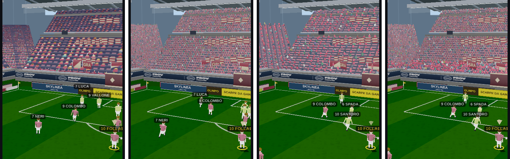
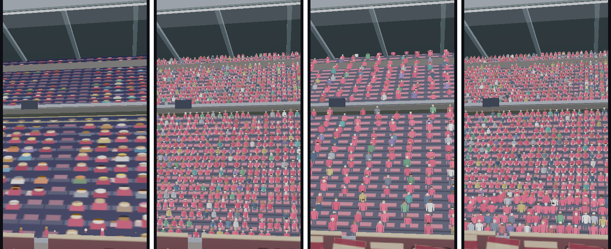

# Giro 128 · PO-330 — «I tifosi sono dei pupazzi»: com'è fatta la folla e tre modi per umanizzarla

**Solo studio.** Il gioco non è stato toccato su questo ramo (`collaudo/giro128-tifosi`, base `lavoro/186`).
Tutto ciò che c'è qui è misura, prototipo isolato e foto. **La scelta resta al PO.**

Richiesta (PO, 08/11): «i tifosi sugli spalti sono tremendi, non è possibile migliorarli / umanizzarli? sono dei
pupazzi». Foto di riferimento: `docs/collaudo-po/184-ingresso-bambini.jpg` sul ramo `poc/marioprada-character-system`
(tribuna a blocchetti colorati con teste tonde).

---

## 1. In breve

- **Oggi la folla è un dipinto.** Ogni settore è un piano inclinato con sopra una tela 2D (`makeCrowdTex`,
  `src/11-ui-kit-highlight.jsx:506`) su cui sono disegnati rettangoli (busto) e cerchi (testa). Le «persone» sono
  larghe **1,8 unità** (0,55 colonne per unità), cioè quanto un giocatore e mezzo: per questo da vicino sembrano
  pupazzi a blocchetti. Le uniche figure 3D sono le **prime file** (cilindro + sfera, 492 figure).
- **Il costo vero di oggi è il ridisegno, non la geometria.** In headless, a parità di tutto, la folla animata
  porta il fotogramma da **58 ms (folla ferma) a 224 ms** a 360x800 e da **207 a 534 ms** a 1440x900. Ogni
  ridisegno ricarica sulla GPU fino a **tre texture da 2 MB** (una tela, tre `CanvasTexture`).
- **Tre prototipi**, tutti generati in casa (nessuna risorsa esterna, nessuna licenza di terzi):
  **A** impostori (un quadrato per tifoso da un atlante di persone disegnate), **B** figure 3D low-poly istanziate
  (~110 triangoli), **C** miscela (prime 4 file in 3D, il resto impostori). Tutti animano il tifo **nel vertex
  shader**: zero ridisegni di tela, zero caricamenti di texture durante la partita.
- **Raccomandazione (motivata più sotto, decide il PO): A**, con la densità da scegliere sul telefono.
  Dalla camera di gioco A e C sono **indistinguibili** nelle foto, ma C costa **8 volte i triangoli**; B alla
  densità di oggi resta rado e costa 750.000 triangoli.
- **Limite onesto:** l'headless rende in software (SwiftShader). Penalizza in modo sproporzionato i frammenti
  con trasparenza a soglia (gli impostori) e **non dice** quanti fps farà un Android di fascia media. Per questo
  c'è un **banco autonomo** da aprire sul telefono (§6). **Non posso confermare** gli fps sul dispositivo finché
  il PO non lo fa girare.

*Stessa camera (dal campo verso tribuna e curva), 360x800, ora congelata «giorno». Da sinistra: oggi, A, B, C.*

*Stessa camera ravvicinata sulla tribuna. Da sinistra: oggi, A, B, C.*

---

## 2. Com'è fatta oggi (misurato)

Stadio forzato `moderno_it` da 50.000 posti, contesto folla forzato (riempimento 0,85, ospiti 0,60, intensità
0,85), scena gi13, ora congelata «giorno», GLB spento (i giocatori non c'entrano con la folla e il caricamento
CH38 in headless falserebbe i tempi). Sonda `tests/visual/folla-128.mjs`.

| Elemento | Com'è fatto | Numeri (360x800) | Numeri (1440x900) |
|---|---|---|---|
| Piani-pubblico | `PlaneGeometry` inclinati per anello + rampe d'angolo, `MeshLambertMaterial` con la tela come `map` | 13 piani · 120 triangoli | idem |
| Tele | 5 tele 2D a 512 px d'altezza (4 settori + una 2048x512 che non ho identificato) | 4×1024 + 1×2048 | 5×2048 |
| Texture GPU | **11 oggetti `CanvasTexture`** su 5 tele: `texLow`/`texUp`/`texFull` sono tre texture distinte della stessa tela, ognuna caricata e mipmappata per conto suo | **≈32 MB** stimati | **≈59 MB** stimati |
| RAM delle tele | — | 12 MB | 20 MB |
| Prime file 3D | `InstancedMesh` cilindro 6 lati + sfera 7x5, colore per istanza, saltello sulla CPU solo nei momenti caldi | 8 draw call · 492 figure · **19.680 triangoli** | idem |
| Animazione | un settore ridisegnato ogni 110 ms a riposo (33-50 ms nei gol), giro a turno sui 4 settori | — | — |
| Ridisegno di una tela, solo JS | `redraw()` isolato (`folla-128-ridisegno.mjs`) | 3,3-3,7 ms | 1,5-3,6 ms |

Costo per fotogramma (media delle viste gioco/TV/vicino, due giri a pagina nuova; **fotogramma** = intervallo
fra due `requestAnimationFrame`; **render** = ms di CPU dentro `renderer.render`):

| Braccio | 360x800 fotogramma (p95) | 360x800 render | 1440x900 fotogramma (p95) | 1440x900 render | Caricamenti GPU |
|---|---|---|---|---|---|
| Folla accesa (com'è oggi) | **224 ms** (616) | 7,4 ms | **534 ms** (918) | 12,0 ms | 5,5-8,5 MB/s* |
| Folla ferma (visibile, niente ridisegni) | 58 ms (90) | 9,2 ms | 207 ms (247) | 10,5 ms | 0 |
| Folla spenta (piani e prime file nascosti) | 36 ms (53) | 6,8 ms | 190 ms (299) | 10,4 ms | 0 |

\* In headless i caricamenti avvengono solo quando c'è un fotogramma (4-5 al secondo). **Stima per il telefono, non
misurata:** a 60 fps la cadenza di 110 ms dà ~9 ridisegni al secondo, ciascuno con 2-3 caricamenti da 2 MB più la
rigenerazione delle mipmap: **nell'ordine di 36-55 MB/s** verso la GPU per la sola folla a riposo.

Cosa dicono i numeri:
- La CPU dentro `renderer.render` non cambia (7-12 ms in tutti i bracci): **la differenza sta nel processo GPU**
  (raster della tela, copia, mipmap), che l'headless non separa ulteriormente.
- Il ridisegno JS da solo costa 2-4 ms: il resto del prezzo dell'animazione è a valle, nel caricamento.
- Trovato per strada, indipendente da qualunque opzione: **tre texture per tela** triplicano memoria e caricamenti.
  Usare una sola texture per tela (con le coordinate UV sul piano invece di `offset/repeat`) li dividerebbe per tre.

Foto di oggi: `foto/oggi-{gioco,tv,vicino,ingresso}-{360x800,1440x900}-{accesa,statica,spenta}.png`.

---

## 3. I tre prototipi

Codice: `prototipi/folla-128/folla-proto.js` (un solo file, nessuna dipendenza oltre a three.js r128, che il gioco
già usa con licenza MIT). La sonda `tests/visual/folla-128-proto.mjs` apre la partita vera, aspetta che la scena
sia costruita, inietta il prototipo, che **riconosce i piani-pubblico, li sostituisce con una gradinata di soli
sedili** (una texture 64x64 statica nei colori del club) e ci mette sopra la gente. Stesse camere, stesse misure.
Le foto «-tifo» sono scattate con l'eccitazione a 0,9 (come in un gol): braccia alzate e saltello.

### A — Impostori («sagome» disegnate in casa)
- Un quadrato (2 triangoli) per tifoso, orientato verso il campo. **Atlante procedurale** 768x256: 12 varianti
  (corporatura, capelli, cappellino, sciarpa, barba, occhiali, capelli lunghi) × 2 pose (braccia giù / su, bocca
  che canta), più una **maschera** che dice dov'è la maglia: la maglia si tinge per istanza con il colore del club
  e mantiene l'ombreggiatura.
- Tifo nel vertex shader: ondeggiamento, saltello e cambio di posa con soglie per istanza (non tutti insieme).
- Densità **vera** (un posto ogni 0,62 × 0,85 unità): **22.139 tifosi**. Variante **A-oggi** alla densità di oggi:
  **6.712**.

### B — Figure low-poly istanziate
- Busto rastremato, testa, calotta di capelli, braccia, gambe: **110 triangoli**. Colori per regione (maglia,
  pelle, capelli, pantaloni) e per istanza; braccia che ruotano attorno alla spalla e saltello nel vertex shader.
- Alla densità di oggi: **6.787 figure = 746.570 triangoli**, un draw call. Alla densità vera sarebbero ~2,4
  milioni: non l'ho nemmeno provato, non sta in un telefono.

### C — Miscela
- Prime 4 file di ogni anello basso in B (2.841 figure), tutto il resto in A (19.310 impostori): **351.130 triangoli**.

---

## 4. Tabella comparativa

Costi **misurati** in headless (media delle viste gioco/TV/vicino, un giro per braccio) e **stimati** dove è
scritto. Memoria GPU = texture + buffer d'istanza, calcolata dalle dimensioni.

| | Oggi (accesa) | **A** impostori, densità vera | A-oggi | **B** low-poly | **C** miscela |
|---|---|---|---|---|---|
| Tifosi | dipinti sulle tele (non contati) + 492 in 3D | 22.139 | 6.712 | 6.787 | 2.841 3D + 19.310 |
| Triangoli della folla | 120 + 19.680 | **44.278** | 13.424 | **746.570** | **351.130** |
| Draw call della folla | 13 + 8 | 1 (+12 piani-sedile) | 1 (+12) | 1 (+12) | 2 (+12) |
| Memoria GPU folla | **≈32 MB** (mobile) / 59 MB | **≈4,3 MB** | ≈2,9 MB | ≈1 MB | ≈4,2 MB |
| Caricamenti texture in partita | 36-55 MB/s stimati sul telefono | **0** | 0 | 0 | 0 |
| CPU per fotogramma della folla | ridisegno tela 2-4 ms ogni 110 ms + caricamenti | 2 uniform | 2 uniform | 2 uniform | 2 uniform |
| Costruzione | — | 29-37 ms | 14-22 ms | 15-16 ms | 34-40 ms |
| Fotogramma headless 360x800 (p95) | 224 ms (616) | 370 ms (761) | **145 ms (358)** | 542 ms (723) | 539 ms (889) |
| Fotogramma headless 1440x900 (p95) | 534 ms (918) | 559 ms (746) | **311 ms (487)** | 885 ms (1109) | 891 ms (1148) |
| Collo di bottiglia atteso sul telefono | caricamenti + raster tela | frammenti con soglia alfa (sovrapposizione) | idem, un terzo | vertici | vertici + frammenti |
| Resa da vicino | blocchetti con testa tonda | persone leggibili, braccia, sciarpe | persone, più rade | figure vere ma rade e «manichino» | come A, prima fila 3D |
| Resa dalla camera di gioco | macchie a scacchiera | folla fitta e varia | folla rada | spalti mezzi vuoti | **uguale ad A** |
| Rischio | — | medio: costo dei frammenti su GPU a tasselli (Mali/Adreno) da verificare sul telefono | basso | alto: 750k triangoli oltre al resto della scena | alto: somma dei due rischi |
| Tempo di realizzazione nel gioco (stima, non misura) | — | **3-4 giorni** | (è A con un parametro) | 4-6 giorni + un LOD obbligatorio | 6-8 giorni |
| Risorse / licenze | — | nessuna: atlante disegnato dal codice | nessuna | nessuna | nessuna |

Come leggere le righe headless: **valgono i confronti fra bracci, non i valori assoluti.** Il rendering software
paga le trasparenze a soglia molto più di una GPU vera: per questo A alla densità vera sembra caro quanto la folla
animata di oggi, pur avendo zero caricamenti e 1 draw call. **Non posso confermare** che sul telefono l'ordine
resti lo stesso: lo dirà il banco del §6.

---

## 5. Raccomandazione (la scelta è del PO)

**A, impostori**, con queste motivazioni:
1. **È l'unica che cambia la resa dalla camera di gioco**, che è quella che il PO guarda per tutta la partita: le
   foto mostrano A e C indistinguibili da lì (`confronto-ingresso-360.png`), quindi la parte 3D di C si pagherebbe
   solo nelle inquadrature ravvicinate.
2. **Toglie il costo che oggi pesa di più** (ridisegni e caricamenti continui di tele da 2 MB) e porta la memoria
   GPU della folla da ~32 MB a ~4 MB.
3. **Triangoli trascurabili** (44k) e un draw call: il rischio si concentra in una sola cosa misurabile (i
   frammenti), che ha due manopole già pronte — la densità (A ↔ A-oggi) e la dimensione del quadrato.
4. Nessuna risorsa esterna, nessuna licenza da verificare.

Se sul telefono A alla densità vera risultasse pesante, la ritirata è **A-oggi** (stessa resa per persona, un
terzo dei tifosi), che anche in headless è già più leggera della folla animata di oggi (145 contro 224 ms a 360x800; 311 contro 534 a 1440x900).

B e C li sconsiglio per il telefono: il loro costo (350-750k triangoli) è nello stesso ordine di grandezza di
tutto il resto della scena, e il guadagno visivo si vede solo da vicino.

---

## 6. Cosa resta da fare prima di decidere — e cosa servirebbe per realizzarla

**Misura sul dispositivo (necessaria):** `prototipi/folla-128/banco.html` è un banco autonomo (three.js r128 da
cdnjs, lo stesso CDN del gioco, + `folla-proto.js`): quattro settori a due anelli, camera simile alla vista TV,
pulsanti *Oggi · A · A-oggi · B · C · Spenta · Gol*, e in alto **fps, ms per fotogramma con p95, triangoli, draw
call**. Il modo «Oggi» del banco **emula** il costo di oggi (tele 1024x512 dipinte e ridisegnate ogni 110 ms,
tre texture per tela) ma non ne copia la grafica: serve a confrontare i costi, non la resa. Verificato in headless
che tutti i modi partono senza errori (`tests/visual/folla-128-banco.mjs`, foto `foto/banco-*.png`). Il banco va
pubblicato dove il telefono lo può aprire: su questo ramo non è servito da GitHub Pages.

**Per portare A nel gioco** (fuori ambito di questo giro, elenco per la stima):
- sostituire il disegno delle persone in `makeCrowdTex` con la gradinata di soli sedili e generare le istanze in
  `buildStadium`, **riusando la logica che già esiste** per decidere chi siede dove: riempimento per anello e per
  fila, gruppi contigui e blocchi vuoti (7.187), corridoi, spicchio ospiti, settore VIP, tribuna famiglie;
- portare nell'atlante ciò che oggi è disegnato: bandiere, sciarpe alzate, ombrelli con la pioggia (23/09),
  bambini delle famiglie; striscioni ultras e coreografie restano come sono;
- collegare le reazioni che oggi sono nella tela (gol della propria squadra / degli avversari, applauso, ola,
  seduti che si alzano) a uniform e attributi per istanza;
- seme deterministico come oggi (`hashStr` del settore): nessun `Math.random` nuovo;
- guardiani: nessuna tela ridisegnata durante la partita, zero caricamenti di texture a regime, conteggio
  tifosi coerente con l'affluenza dichiarata dalla MatchdayCard, foto GLB-ON di ingresso e gioco;
- la catena di rilascio è quella **grafica** se non si tocca altro (`griglia-mobile`, `design-system`,
  `career-critical`, `test:logic`, `save-compat`); nessun campo nuovo nel salvataggio.

**Cose da sistemare nel prototipo prima di portarlo:** i sedili vuoti sono troppo rosati (il miscuglio col
colore del club è da ritarare); i pantaloni scuri si vedono troppo quando la camera è bassa; l'atlante va
ricontrollato con il CH38 accanto per le proporzioni (direttiva PO 29/07: le verifiche percettive si fanno
GLB-ON; qui la folla è stata fotografata GLB-OFF perché il confronto riguarda solo gli spalti).

---

## 7. Strumenti lasciati (nessuno è un guardiano)

| File | Cosa fa |
|---|---|
| `tests/visual/folla-128.mjs` | misura la folla di oggi in tre bracci (accesa / ferma / spenta) e fotografa da quattro camere; riconosce la folla dal di fuori (tele 1024/2048x512, prime file r0,17/r0,145) senza toccare il gioco |
| `tests/visual/folla-128-ridisegno.mjs` | costo JS di un singolo `redraw()` della tela |
| `tests/visual/folla-128-proto.mjs` | inietta il prototipo nella scena vera e misura/fotografa A, A-oggi (`Ao`), B, C |
| `tests/visual/folla-128-banco.mjs` | prova headless del banco autonomo |
| `prototipi/folla-128/folla-proto.js` | i tre prototipi |
| `prototipi/folla-128/banco.html` | banco da aprire sul telefono |
| `docs/collaudo-grafico/128/misure-*.json` | numeri grezzi |

Uso: `cd tests/visual && export CPM_CHROME=/opt/pw-browsers/chromium && CPM_VP=360x800 node folla-128.mjs`
(`CPM_GIRI`, `CPM_BRACCI`), `CPM_MODI=A,Ao,B,C CPM_VP=360x800 node folla-128-proto.mjs`.

**Limiti della misura, dichiarati:** headless software (vale il confronto, non il valore); un solo stadio
(`moderno_it`, 50.000) e un solo contesto (riempimento 0,85); un giro per i prototipi contro due per oggi; la
quinta tela 2048x512 a 360x800 non è stata identificata; la memoria GPU è calcolata dalle dimensioni, non letta
dal driver; ora congelata «giorno» (la notte non è stata fotografata).
