# Rapporto giro 290 · PO-549: avviso «momenti salienti» nella finestra della settimana

Versione di destinazione: 7.999.198 (rapida). Ramo `sviluppo/giro290-avviso-salienti`, partito da `lavoro/198`.
`GAME_VERSION` non è stato toccato.

## Il problema (foto del PO)

Nella finestra della settimana («Settimana 1 · Primavera 2 — vs FC Altoadige Primavera — Sei titolare — GIOCA LA
PARTITA / Simula e avanza la settimana / Non ora») il PO ha scritto «non c'è il gioco solo azioni salienti».
Il tasto c'è, ma sta nella pre-partita, come aveva deciso il PO il 17/11 (giri 243, 246): un solo punto per tutte
le partite. Il 19/11 il PO ha risposto: «dove vuoi basta che sia in unico punto per tutte le partite».

## Cosa cambia

Una sola riga di testo, «**Nella pre-partita puoi giocare solo i momenti salienti**», sotto il «Gioca» di ogni
schermata che porta alla pre-partita. Non ci sono tasti nuovi e i percorsi restano gli stessi.

| Dove | File | Condizione |
|---|---|---|
| Finestra della settimana (titolare, panchina, Primavera, coppe, Europa, Nazionale) | `src/18` (modale `partita23`) | la stessa del tasto «Gioca»: convocato, non infortunato, non squalificato, «Simula» non scelto |
| Card «Prossima» della home | `src/18` (`prossima-v2`) | tasto attivo, non infortunato, settimana vissuta, non svincolato, c'è una partita della settimana o della Nazionale |
| Convocazione della Nazionale | `src/17` (`NationalCallupScreen`) | sempre (si arriva lì solo per giocare) |
| Lobby Coppa delle Nazioni | `src/18` | non infortunato |
| Lobby Europeo/Mondiale | `src/18` | torneo in corso, non infortunato |
| Provino | `src/17` (sotto «Inizia il provino») | il provino passa dalla pre-partita (giro 246); sotto `?cpmtest` solo col gancio `__CPM_PREP246`, come la pre-partita |

Il componente è uno solo, `AvvisoSalienti290` (`src/11`), e usa i token del tema (`FS.small`, `TH.muted`). Nella
card «Prossima», che ha come sfondo il colore del club, usa l'inchiostro della card (`_ink`). La riga sparisce
anche quando sono spenti i giri da cui dipende il tasto (`__CPM_NO_G246`, `__CPM_NO_G243`, `__CPM_NO_G166`):
così non promette un tasto che nella pre-partita non c'è.
**Rosso `window.__CPM_NO_G290`**: la riga non compare, come prima.

Non ho toccato la pre-partita e le scritte «[0]» (giri 287 e 288, in parallelo).

## Foto prima / dopo (telefono 360×800)

Sono in `docs/sviluppo/foto-giro290/`: `prima-*.png` (braccio rosso, cioè com'era) e `dopo-*.png`.

| Percorso | Prima | Dopo |
|---|---|---|
| Finestra della settimana, titolare | 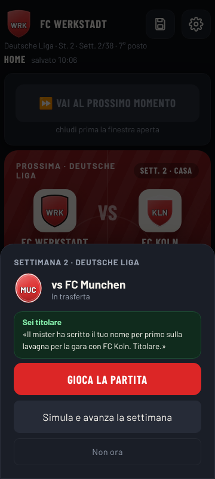 | 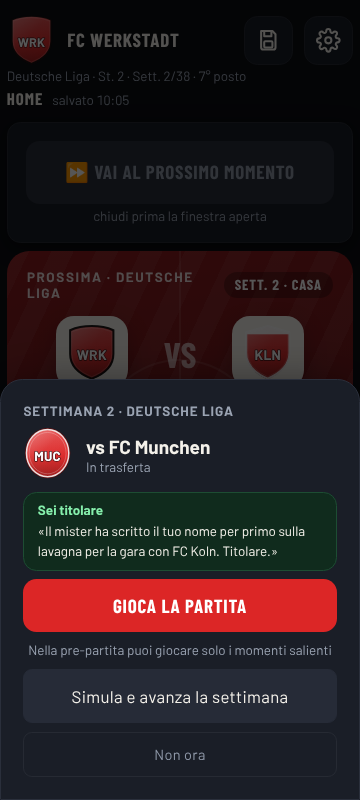 |
| Finestra della settimana, panchina | 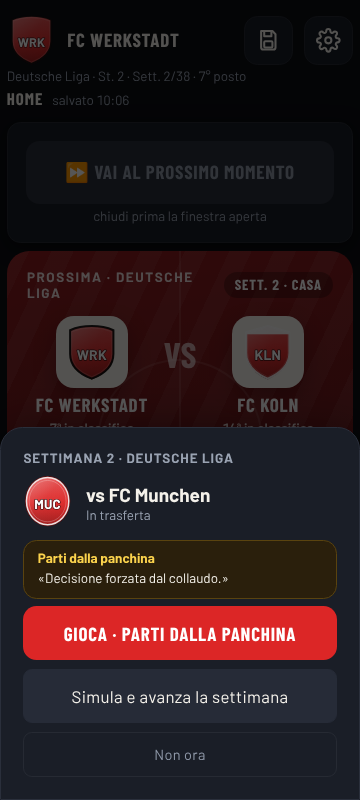 | 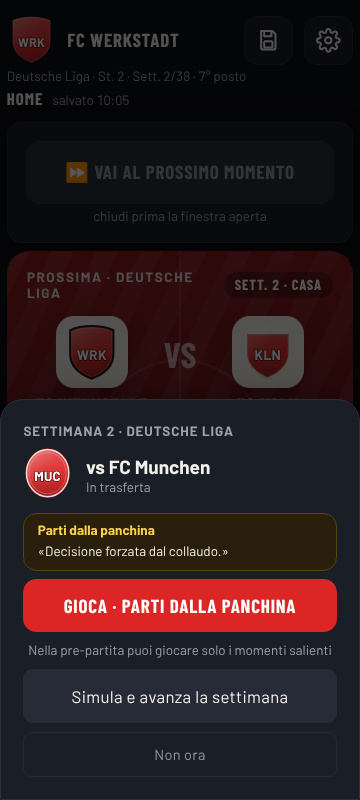 |
| Card «Prossima» della home | 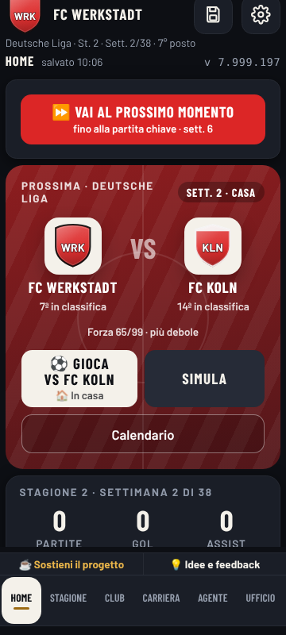 | 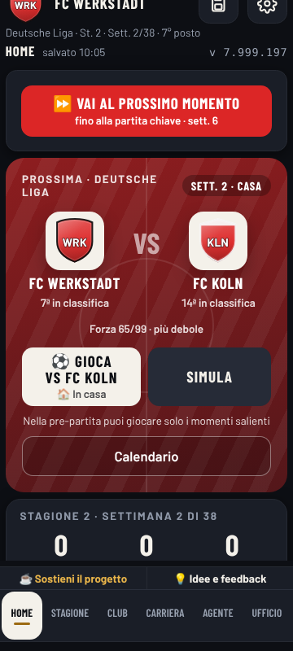 |
| Convocazione della Nazionale |  | 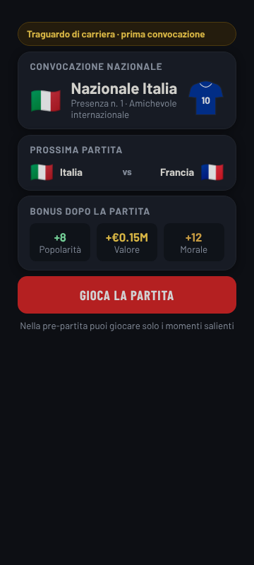 |
| Lobby Coppa delle Nazioni | 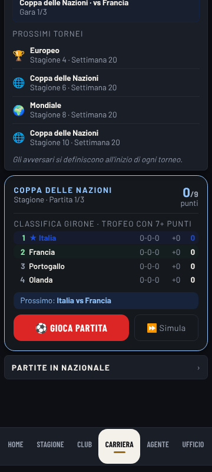 | 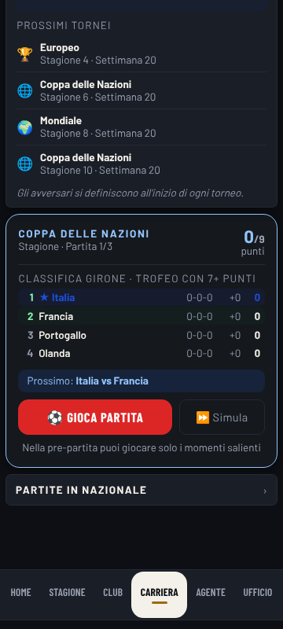 |
| Lobby Mondiale | 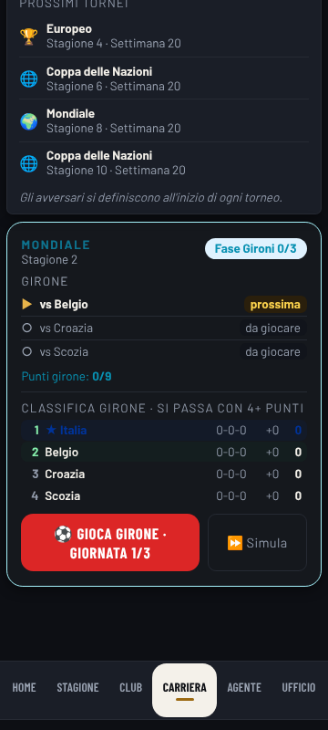 | 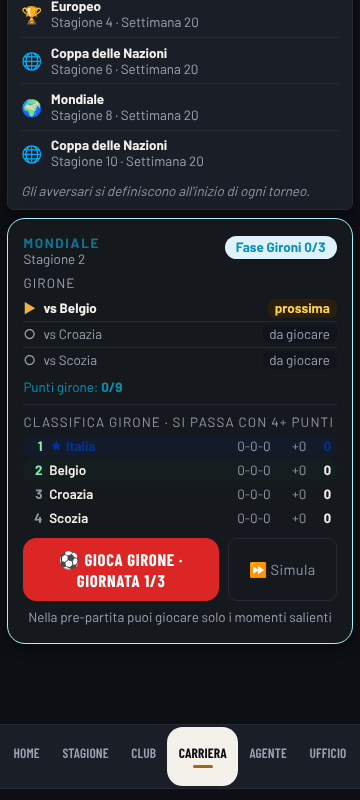 |
| Provino | 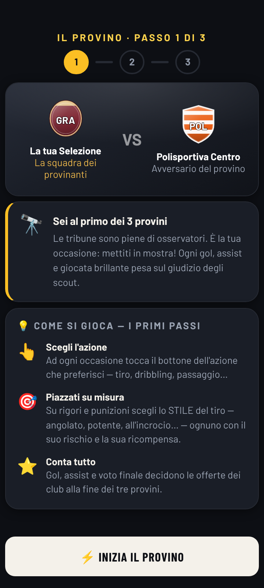 | 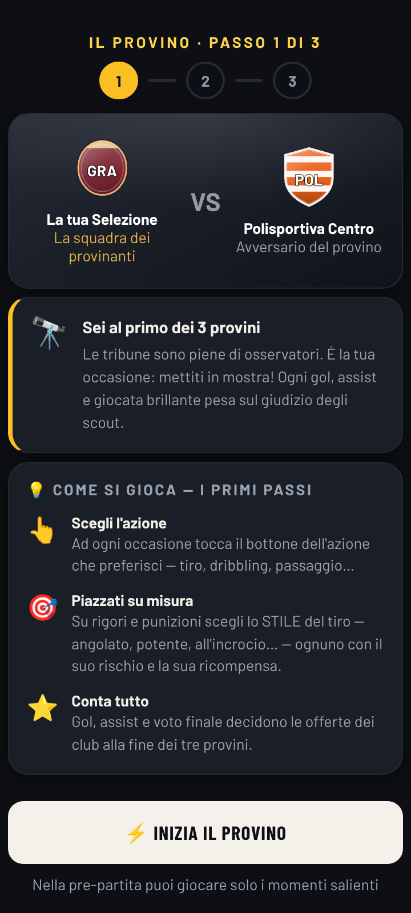 |
| Pre-partita che segue (invariata, col tasto) | 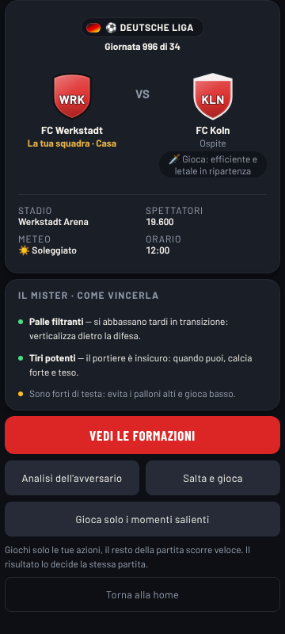 |  |

## Guardiano nuovo: `npm run avviso-290`

Gioca davvero e non legge il sorgente. Telefono 360×800. Percorre otto strade: finestra della settimana da titolare, dalla
panchina e in Primavera U18, amichevole della Nazionale (finestra → convocazione), card «Prossima» della home
(→ finestra), lobby della Coppa delle Nazioni, lobby del Mondiale, provino. Su ognuna controlla cinque cose:
1. la riga c'è, una sola volta, col testo esatto, accanto al «Gioca»;
2. a 360 px non è tagliata: sta dentro lo schermo e dentro la sua scatola, e la pagina non scorre di lato;
3. il punto resta unico: prima della pre-partita non compare nessun tasto dei momenti salienti;
4. la promessa è mantenuta: la pre-partita che segue ha davvero il tasto `solo-243`;
5. errori di pagina: zero.

In più c'è un caso da infortunato: nella finestra non c'è «Gioca» e quindi non c'è la riga.

**Esito misurato:** VERDE 8/8 percorsi passano, più il caso dell'infortunato. ROSSO (`__CPM_NO_G290`): cade su
8/8 percorsi, e su ognuno la pre-partita è stata raggiunta, quindi il giudizio è valido. Uscita 0.

## Controlli eseguiti (uno alla volta, `CPM_CI_PAR=0`, `CPM_CHROME=/opt/pw-browsers/chromium`)

| Controllo | Esito |
|---|---|
| `node tools/build-src.mjs` + `node tools/check-src.mjs` | IDENTICO byte per byte |
| `avviso-290` | verde PASSA · rosso CADE su ogni percorso |
| `salienti-243` | verde PASSA · rosso CADE |
| `salienti-229` | verde PASSA · rosso CADE |
| `griglia-mobile` | uscita 0, 14 schermate × 5 larghezze (foto di `docs/collaudo-grafico/g0` rimesse con `git checkout --`) |
| `test:logic` | 51 pass · 0 fail |
| `save-compat` | 12 pass · 0 fail |
| `career-critical` | uscita 0 (tutta la catena verde) |

Non ho eseguito `salienti-246`, `highlight-95`, `ingresso-206` e `ci-runner`. La pre-partita e i percorsi non sono
cambiati, e `avviso-290` arriva fino alla pre-partita sulle stesse strade del 246.

## Dubbi per il PO

1. **Home, tasto in alto «Vai al prossimo momento».** In alto nella home c'è anche un tasto grande che nella foto dice «Vai al prossimo momento». Lì non ho messo la riga perché non è un «Gioca»: porta al prossimo
   momento della stagione, non direttamente alla partita. L'ho messa solo nella card «Prossima», sotto «Gioca vs …».
   Se la vuole anche lì, va deciso.
2. **Card «Prossima» quando il mister ti lascia fuori.** La card della home non sa ancora cosa deciderà il mister
   (la decisione si legge all'apertura della finestra). Se il giocatore non è convocato, la riga compare sulla card
   ma non nella finestra che segue, dove «Gioca» non c'è. È un caso raro e la riga resta vera, perché non promette
   un tasto in quella partita. Lo segnalo comunque.
3. **Testo.** Ho usato alla lettera il testo indicato. Se il PO preferisce un'altra formulazione (per esempio «Nella
   schermata pre-partita…»), basta cambiare una stringa in `AvvisoSalienti290` (`src/11`).
4. **Sonda, non gioco.** Nella foto della finestra da titolare l'avversario scritto nella finestra (FC Munchen) è
   diverso da quello della card e del motivo del mister (FC Koln). Viene dalla giornata che la sonda inietta con
   `apriPartita` sopra il salvataggio di prova, non da un percorso giocato. Non l'ho indagato perché è fuori ambito.
5. **Roadmap.** Non ho scritto la riga in `docs/governo/ROADMAP.md`: la versione 7.999.198 la chiude la sessione
   madre insieme ai giri 287 e 288.
