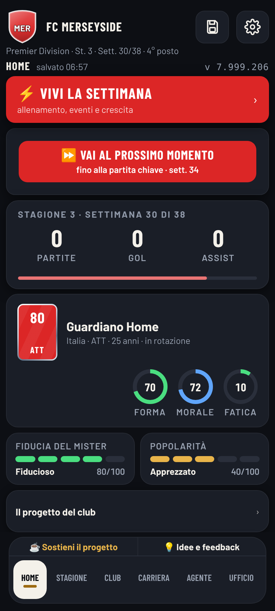
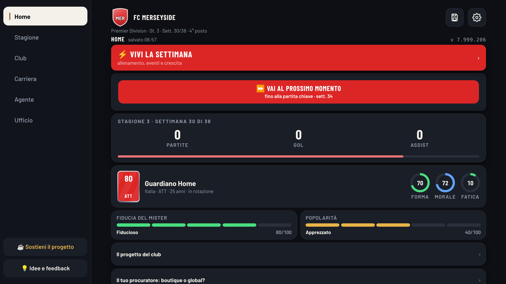
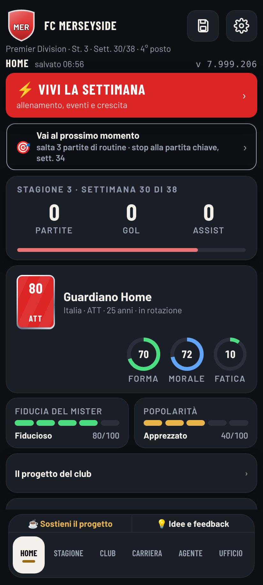
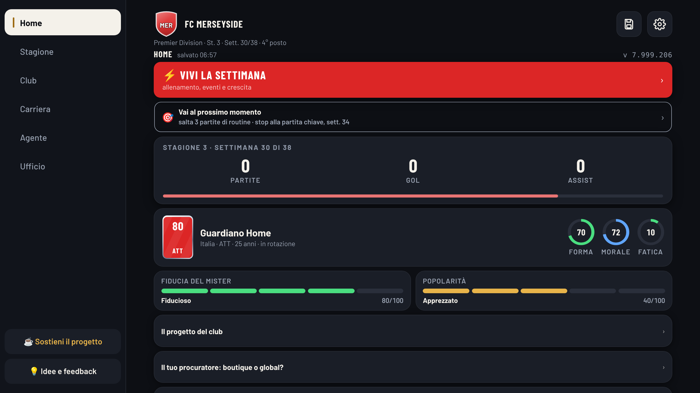
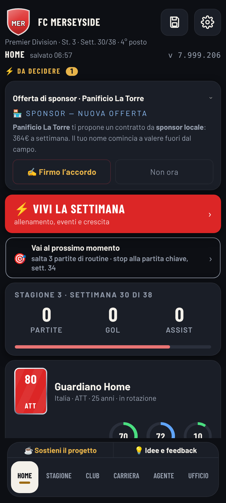
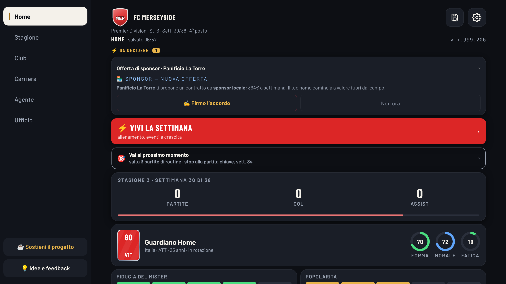

# Giro 335 — Home: un solo tasto primario, «Da decidere» in cima (PO-623 · PO-615)

Base: `lavoro/201` (d681977). Ramo: `sviluppo/giro335-home-tasti`. GAME_VERSION non toccata (rilascio automatico del vagone).
File di gioco toccato: solo `src/18-career-app.jsx` (+ `CARRIER-MANAGER-AV.html` ricomposto, check-src identico).

## PO-623 — «I due pulsanti rossi con le frecce fanno a cazzotti»

**Causa misurata.** Il tasto «Avanza/Vivi la settimana» (`avanza23`) usa `tasto235` = colore del club; dal giro 194 (PO-411)
anche «Vai al prossimo momento» (`salta163-tasto`) è pieno nel colore del club. Su FC Merseyside sono due rossi pieni,
icone ⏭/⏩ quasi identiche. Misura del guardiano sulla Home di oggi: **2 tasti pieni** fra i tasti larghi dei primi due schermi.

**Fatto.**
- «Avanza/Vivi la settimana» resta **l'unico tasto pieno** (invariato).
- «Vai al prossimo momento» diventa **secondario**: fondo trasparente, filo `TINTE.sec` (7,5:1 sul fondo), testo `TINTE.testo`
  in caratteri normali a sinistra, icona **🎯** (non più ⏩), freccia `›` in `TINTE.sec`. Sotto, una riga breve che dice cosa salta:
  «salta N partite di routine · stop alla partita chiave, sett. X» (oppure «salta fino a fine stagione»). Il titolo resta
  «Vai al prossimo momento» perché lo cercano otto sonde. Stesso tocco, stesso pannello di conferma, stesso stato spento/rinnovo.
- Da professionista il riquadro `corsa163` intorno al solo tasto perde la cornice (non sembra più un secondo blocco).
  In Primavera la cornice resta (c'è anche la barra dell'Indice).
- Solo token del tema (`TINTE`, `TH`, `FS`, `FW`, `SP`, `RAD`): nessun colore scritto a mano.

| | Telefono 412 | PC 1366 |
|---|---|---|
| Prima |  |  |
| Dopo |  |  |

Foto del PO: `docs/collaudo-po/202-home-due-tasti-rossi.jpg` (sul ramo poc).

## PO-615 — «questi box all'occorrenza si perdono nella home»

**Causa misurata.** Il blocco «Da decidere» esisteva già (giro 199, PO-408) ma (1) stava **sotto** il tasto principale e
(2) non conteneva l'**offerta di sponsor** (Firmo / Non ora), che restava in fondo alla Home come fisarmonica **chiusa**:
misurata a 805 px al telefono 412×915 e 726 px al PC, cioè sotto la piega.

**Fatto.**
- «Sei svincolato» + «Da decidere» salgono **sotto la testata e sopra i tasti** (stesso pezzo, stesso ordine del giro 198/199).
- L'offerta di sponsor entra nel blocco (chiave `sponsor`), **aperta**, conta nel contatore, con le sue due azioni.
- Nessuna finestra nuova (PO-224 chiusa): il conteggio delle finestre è identico alla Home senza decisioni.
- Il tasto principale, appiccicato in cima, con il blocco sopra non risale più su di esso (margine 0 invece di −10).

| | Telefono 412 | PC 1366 |
|---|---|---|
| Prima |  |  |
| Dopo |  |  |

Foto del PO: `docs/collaudo-po/201-home-box-sponsor.png` (sul ramo poc).

**Il «Patto col mister».** Nella foto 201 è la barra di **avanzamento** del patto (0/2 assist · gara 0/6): non è una decisione,
quindi resta dov'è. La **proposta** del patto («Ci sto» / «Parlo sul campo») passa già dalla finestra `_pop224` al momento giusto;
non l'ho spostata (cambierebbe la precedenza delle finestre del giro 224). Vedi dubbio 2.

## Guardiano `npm run home-335`

Riga della MAPPA `src/18-|src/10-` in `ci-runner.mjs` (quella già esistente per il file toccato). Gioco vero (`?cpmtest=1`),
salvataggio del giro 199 (FC Merseyside, il caso della foto), settimana senza partita (tasto appiccicato in cima come nella foto).
Telefono 412×915 e PC 1366×768:
- **T**: fra i tasti larghi (≥ 60% della colonna, ≥ 44 px) dei primi due schermi **uno solo pieno**; «Avanza» pieno; tasto del
  momento non pieno, filo ≥ 3:1 sul fondo, alto ≥ 44 px, icona diversa da «Avanza»; il tocco apre ancora la conferma.
- **D**: con l'offerta di sponsor: sezione presente, contatore = `data-n` = decisioni dentro, offerta dentro e aperta
  («Firmo» visibile), sezione sopra la piega **e** sopra «Avanza», nessuna finestra in più.
- Rosso `window.__CPM_NO_G335` = Home di oggi → **deve** essere bocciato su T e D. Non giudicato = rosso. Zero errori di pagina.

Esito (prima stesura): **verde 4/4, rosso bocciato 4/4** — T verde: avanza pieno · momento filo 7,54:1 h58; D verde:
sezione a 122 px (telefono) / 129 px (PC), «Firmo» a 290 / 256, «Avanza» a 354 / 320. Rosso: 2 tasti pieni; sezione assente.

**Guardiani adeguati alla decisione (nessuna soglia toccata):**
- `momento-194` parte C (tasto pieno nel colore del club, giro 194) giudica ora quel ramo dove esiste ancora, cioè con
  `__CPM_NO_G335`; il suo rosso è `__CPM_NO_G335`+`__CPM_NO_G194C`. Verde.
- `home-199`: il salvataggio declina l'offerta di sponsor per la stagione, così il guardiano conta le **sue** tre scelte
  (con popolarità 40 l'offerta ora entra nel blocco e cambierebbe il contatore). Verde.
- `coerenza-235`: verde senza modifiche.

## Catena

`node ci-runner.mjs giro home-335 tocco-213 design-system home-opening home-298` (= i guardiani + 17 sentinelle):
**19/20 verdi** sul commit bcd7428: home-335 ✅ · design-system ✅ · home-298 ✅ · tocco-213 ✅ · le 17 sentinelle ✅
(fra cui partita-vera, career-critical, replay, save-compat, griglia-mobile, schermate-97). Fuori catena, a parte:
home-199 ✅ · momento-194 ✅ · coerenza-235 ✅.

**❌ home-opening — rosso PREESISTENTE, non di questo giro.** «Avvia Stagione» (settimana 1) non apre il wizard d'apertura.
Rifatto sul file di gioco della base `lavoro/201` (d681977) senza nessuna modifica di questo giro: **stesso rosso, stesso
messaggio** («contenuti d'apertura ora a schermo: NESSUNO»). Non è in `ROSSI-DICHIARATI.json`. Non l'ho riparato (fuori
ambito: tocca il percorso d'apertura di stagione, non la Home); va aperta una voce di backlog o dichiarato il rosso.

## Dubbi per il PO

1. **Con tante decisioni il tasto principale scende.** Con una decisione al telefono 412 «Avanza» scende da 114 a 354 px
   (misurato); con piu' decisioni lunghe (saga, shooting, sponsor) puo' finire oltre la piega — non l'ho misurato in questo giro. Opzioni:
   - **(consigliata) A.** Tenerlo così: finché c'è qualcosa da decidere, si decide prima; il tasto resta appiccicato appena si scorre.
   - B. Le decisioni in forma compatta (una riga ciascuna col titolo e le azioni; il testo lungo al tocco), così il tasto resta visibile.
   - C. Il tasto principale fisso in basso sopra la barra delle schede, e «Da decidere» in cima.
2. **Proposta del patto col mister.** Oggi arriva come finestra (`_pop224`) al momento giusto. Opzioni:
   - **(consigliata) A.** Lasciarla in finestra (è già impossibile perderla).
   - B. Portarla anche lei nel blocco «Da decidere» (niente finestra: riapre il tema PO-224).
   - C. In finestra la prima volta, e nel blocco se la si chiude senza rispondere.
3. **Icona e testo del tasto secondario.** Opzioni:
   - **(consigliata) A.** 🎯 «Vai al prossimo momento» + «salta N partite di routine · stop alla partita chiave, sett. X».
   - B. Titolo più corto «Salta alla partita chiave» (va aggiornato il riconoscimento in otto sonde).
   - C. Un solo tasto «Avanza» con una freccia accanto che apre la scelta «una settimana / fino al prossimo momento».
