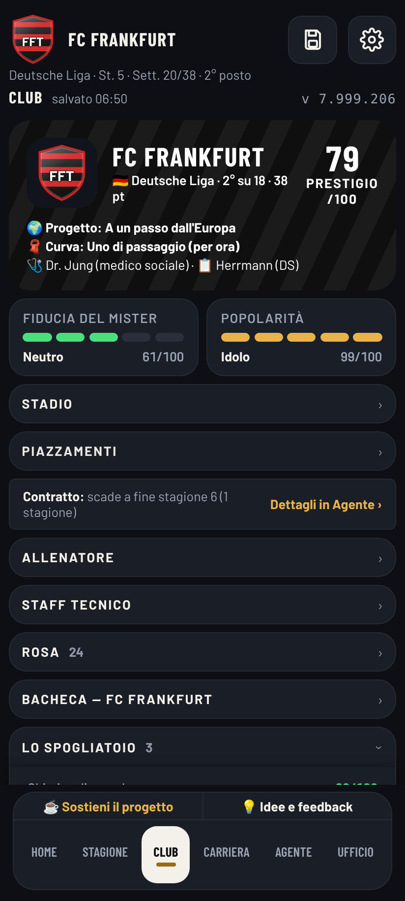
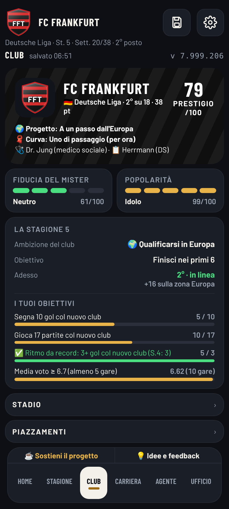
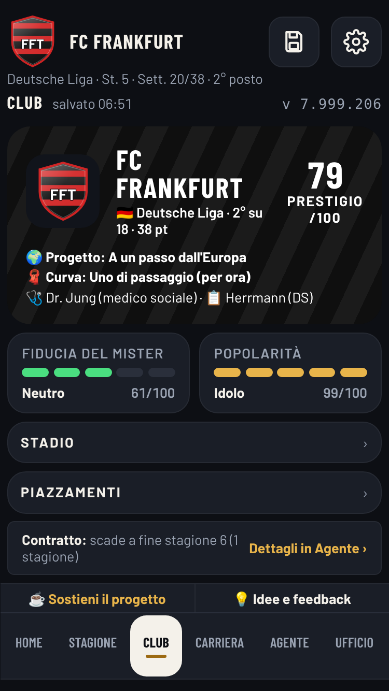
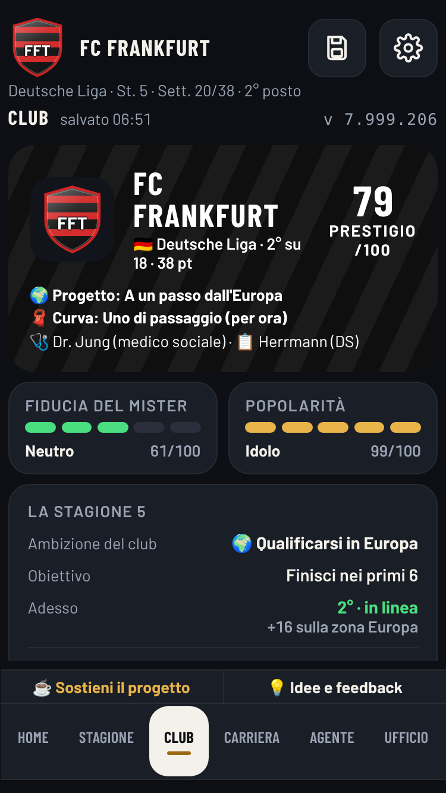
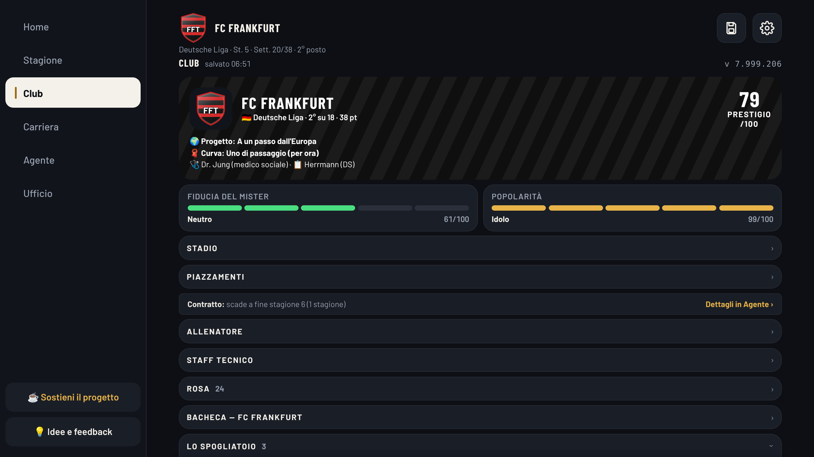
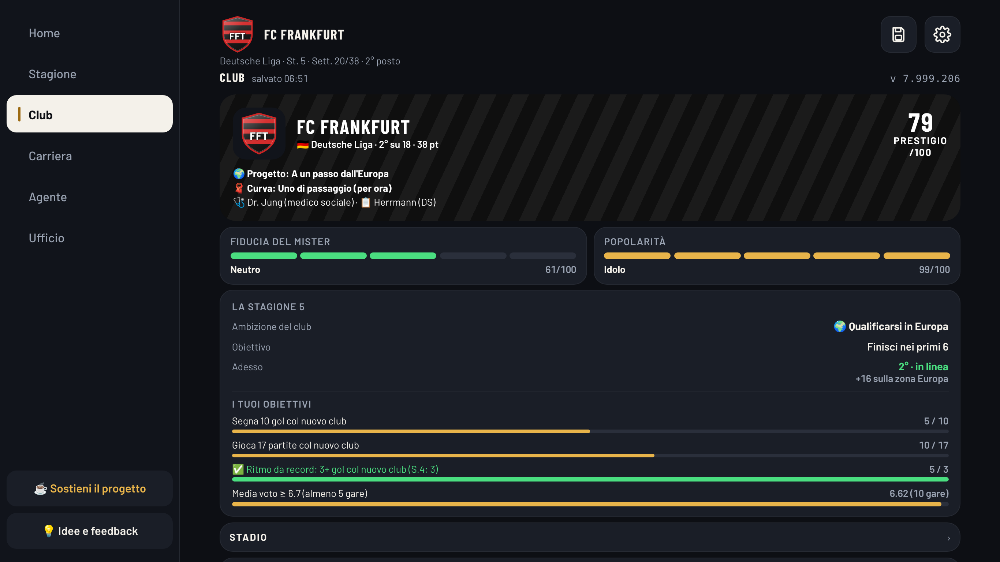

# Rapporto giro 337 — scheda Club: «La stagione» (PO-606) e via il contratto (PO-617)

Base: `lavoro/201` (d681977). Ramo: `sviluppo/giro337-club-stagione`. GAME_VERSION non toccata.

## Il ramo del giro 319

Il compito chiedeva di riusare `sviluppo/giro319-club-obiettivi`. **Sul remoto quel ramo non esiste** (`git ls-remote` non lo
trova, né con quel nome né con «319» o «obiett»), anche se il BACKLOG lo dà per «conservato». Sono ripartito da zero.
Se il PO sa dove sta (magari solo nella sessione del giro 319, mai spinto), va controllato: non ho potuto confrontarlo.

## Cosa chiedeva il PO

- **PO-606** (foto `docs/collaudo-po/200-club-obiettivi.png`): «gli obiettivi della stagione e l'ambizione non è chiara!» — la
  testata dice solo «Progetto solido». Decisione dal questionario: riquadro «La stagione» in cima sotto la testata con ambizione,
  obiettivo di classifica, posizione rispetto all'obiettivo (verde/rosso), obiettivi personali con avanzamento; una fonte sola per
  Home, Club e presidente, con la regola della riga del giro 298.
- **PO-617** (foto `docs/collaudo-po/201-club-contratto.jpg`): «Contratto nella schermata club non ha senso».

## Cosa ho cambiato (src/18-career-app.jsx)

1. **`ambizione337(player, N)`**: la regola del giro 298 tirata fuori da `rigaObiettivo298`, che ora la chiama (stessi risultati:
   `home-298` lo controlla). Dà obiettivo di classifica (dal salvataggio, o dal prestigio con la stessa formula di
   `generateSeasonObjectives`), la zona usata e il nome dell'ambizione:
   🏆 «Vincere il campionato» · 🌍 «Qualificarsi in Europa» (⬆️ «Salire di categoria» in seconda divisione) ·
   ⚖️ «Una stagione tranquilla» · 🛡️ «Salvarsi».
2. **Riquadro «La stagione N»** nella scheda Club, subito sotto testata + fiducia/popolarità, prima di Stadio (solo da professionista):
   - Ambizione del club · Obiettivo («Finisci nei primi N», lo stesso del presidente);
   - **Adesso**: «2° · in linea» in verde se la posizione centra l'obiettivo, «10° · sotto l'obiettivo» in rosso se no; sotto, la stessa
     riga della scheda Classifica («+16 sulla zona Europa»). Prima della 1ª giornata: «Si parte alla 1ª giornata» in grigio;
   - **I tuoi obiettivi**: gli obiettivi del presidente diversi dalla classifica (gol/assist/partite) e i due obiettivi personali della
     Home, ognuno con numeri e barra.
3. **Home** (riquadro «Obiettivi della stagione») e **presidente** (passo d'apertura stagione): una riga «Ambizione del club: …» letta
   da `ambizione337`.
4. **Via la riga «Contratto: … · Dettagli in Agente ›»** dalla scheda Club. Il contratto resta in Agente com'era.

Rosso `window.__CPM_NO_G337` = scheda di oggi (niente riquadro, riga contratto, nessuna riga ambizione in Home e dal presidente).

## Prima / dopo (salvataggio del PO, FC Frankfurt St. 5 Sett. 20)

| | Prima | Dopo |
|---|---|---|
| Telefono 412×915 |  |  |
| Telefono piccolo 375×667 |  |  |
| PC 1366×768 |  |  |

A 412×915 ambizione e obiettivo finiscono a 448 px su 915: sopra la piega senza scorrere.

## Guardiano `npm run club-337` (verde + rosso)

Dal salvataggio `fixtures/save-c177-s5w20`, a 412×915, 375×667 e 1366×768:
- **A** riquadro presente, prima di Stadio; a 412 ambizione e obiettivo dentro lo schermo senza scorrere;
- **B** nessuna riga contratto;
- **C** 3 club veri di prima divisione (FC Islington p91 → primi 3, FC Bilbao p74 → primi 6, FC Almería p60 → primi 9), ognuno al 1° e
  al 10° posto: ambizione e obiettivo del Club = Home = regola ricalcolata dal guardiano; riga di posizione = scheda Classifica;
  colore verde/rosso giusto. **6/6**;
- **D** almeno un obiettivo personale, ognuno con la sua barra.

Misurato: verde ✅ (6/6 in C, 3 risoluzioni); rosso ✅ (`CPM_ROSSO=1`: A, B, C, D riprodotti, 15 rilievi, nessuna misura cieca).
Sta nella riga della MAPPA già esistente per `src/18-|src/10-` (accanto a `home-298`) in `ci-runner.mjs`.

## Catena

`node ci-runner.mjs giro club-337 home-298 design-system career-critical` — esito in fondo (sezione «Esito della catena»).

## Dubbi per il PO

1. **Verde/rosso: obiettivo del presidente o zona della lega?** Oggi il colore segue «Finisci nei primi N» (FC Almería 10° con
   «primi 9» = rosso), mentre la riga sotto segue la zona («+18 sulla salvezza»). Così rosso e «+18» stanno insieme.
   - **a) (consigliata)** il colore segue l'obiettivo del presidente, la riga dice la zona (com'è ora): il PO ha chiesto la posizione
     rispetto all'obiettivo;
   - b) colore e riga seguono entrambi la zona (verde se «+», rosso se «−»);
   - c) tre colori: verde centrato, giallo fuori dall'obiettivo ma fuori pericolo, rosso nella zona sbagliata.
2. **Ambizione per prestigio, non per storia.** La regola del giro 298 (e `generateSeasonObjectives`) usa solo il prestigio; la
   «storia» del club (piazzamenti passati) non entra. Nella foto del PO l'FC Augusta (prestigio 68,7) ha «primi 6», cioè Europa.
   - **a) (consigliata)** lasciare il prestigio: una regola sola, già nei salvataggi;
   - b) correggere l'obiettivo con la media degli ultimi piazzamenti (giro nuovo, cambia i salvataggi solo a inizio stagione);
   - c) mostrare accanto all'ambizione il miglior piazzamento recente come contesto, senza cambiare la regola.
3. **Due obiettivi di gol** nel riquadro (quello del presidente «Segna 10 gol» e quello personale «Ritmo da record: 3+ gol»).
   - **a) (consigliata)** lasciarli: sono due promesse diverse (al club e a te stesso), la Home li mostra già così;
   - b) mostrare solo quelli del presidente e lasciare i personali in Home;
   - c) mostrare solo i personali.
4. **Club di seconda divisione con obiettivo «primi 12»**: la regola del 298 lo porta a «zona promozione» (in seconda divisione non c'è
   retrocessione nel gioco), quindi l'ambizione dice «Salire di categoria» anche a un club debole.
   - **a) (consigliata)** per la seconda divisione con obiettivo oltre il 6 dire «Una stagione tranquilla» (cambia solo il nome, non la riga);
   - b) lasciare così (coerente con la riga della Classifica);
   - c) cambiare anche la riga della Classifica (tocca il giro 298).

## Esito della catena

`node ci-runner.mjs giro club-337 home-298 design-system career-critical` (guardiani del giro + 17 sentinelle), sul build 7.999.206 del ramo:

- ✅ club-337 (68s)
- ✅ home-298 (121s)
- ✅ design-system (0s)
- ✅ mappa-unica (0s)
- ✅ test:logic (3s)
- ✅ save-compat (1s)
- ✅ replay (67s)
- ✅ migrazione-194 (26s)
- ✅ tema-unico (15s)
- ✅ griglia-mobile (200s)
- ✅ render-3d-023 (38s)
- ✅ tunnel-285 (292s)
- ✅ web-237 (55s)
- ✅ career-critical (402s)
- ✅ battito-264 (414s)
- ✅ partita-vera (662s)
- ✅ gk-dive-sync (223s)
- ✅ schermate-97 (120s)
- ✅ catena giro su 7.999.206: 18/18 verdi

Nessun passo instabile, nessun rosso.
