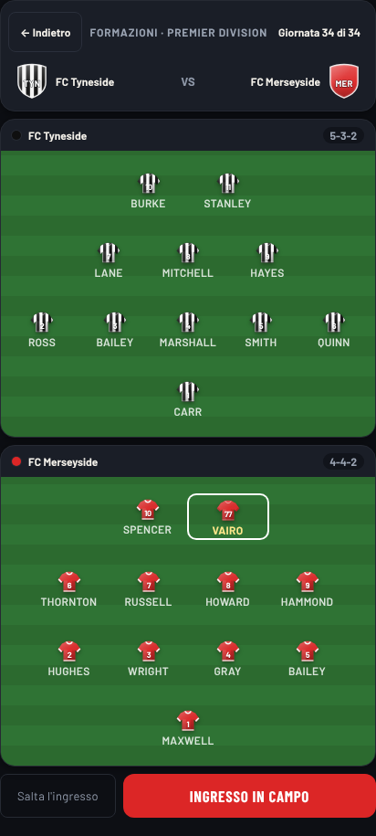
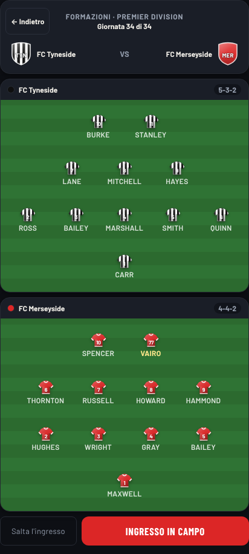
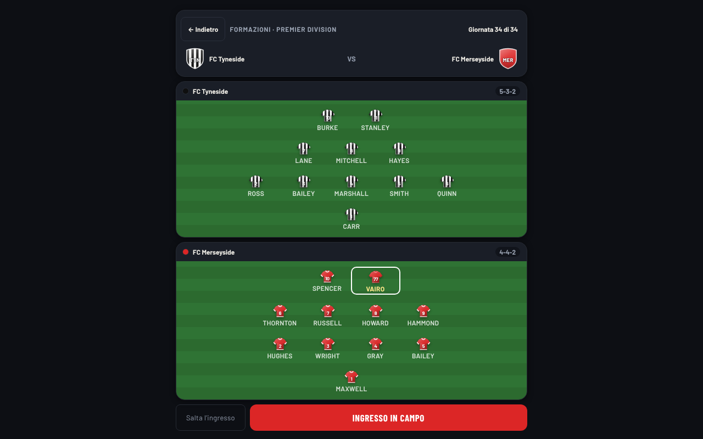
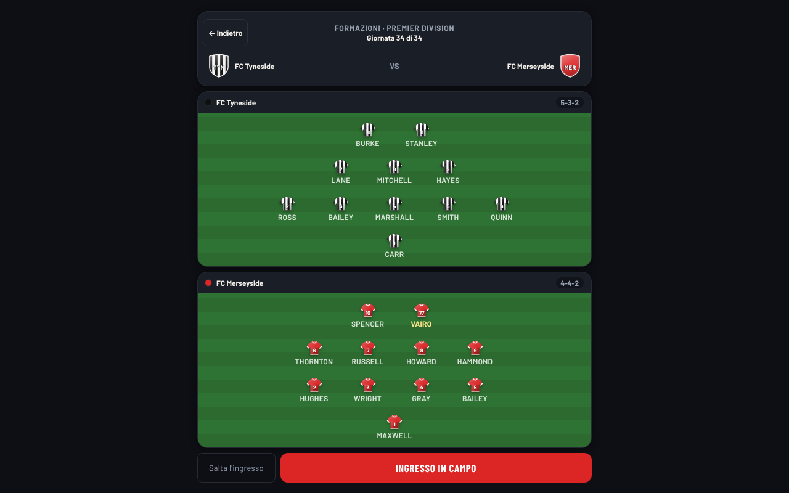
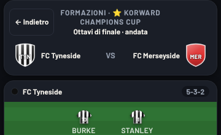

# Rapporto giro 339 — Formazioni: l'eroe veste la divisa dei compagni, niente riquadro, titolo al centro (PO-614 + PO-595)

Base: `lavoro/201` punta `d681977`. Ramo: `sviluppo/giro339-formazioni`. `GAME_VERSION` non toccato (rilascio automatico acceso).
Banco: sessione cloud, `CPM_CHROME=/opt/pw-browsers/chromium`. Soglie: nessuna cambiata.

## Richieste del PO

- **PO-614** (foto `201-formazioni-maglia-eroe.png`): «l'eroe non deve avere una maglia diversa» · «ed il quadrato intorno è brutto,
  lo toglierei».
- **PO-595** (foto `199-formazioni-titolo-centrale.png`): «la scritta formazioni + lega deve essere centrale».

## Causa (letta nel codice, misurata dal guardiano)

- **Maglia.** `JerseyIcon` (src/13) toglieva il disegno del kit (`pat`) e la rifinitura del secondo colore (`_trim`) a chiunque avesse
  `isPlayer`, e il pannello Formazioni non passava all'eroe né `pattern` né `color2`. Misurato sul salvataggio S12 (FC Merseyside,
  rosso con secondo colore bianco): colori disegnati dell'eroe `fill:#dc2626`, dei compagni `fill:#dc2626 fill:#f5f5f5 stroke:#f5f5f5`
  (colletto, polsini e orlo bianchi mancanti all'eroe; sulla squadra della foto, le maniche rosse).
- **Riquadro.** Contenitore dell'eroe con `boxShadow: 0 0 0 2px #ffffff` (scelta del 23/09 «lo distingue il riquadro bianco»).
- **Titolo.** Testata in flex: «← Indietro» a sinistra, titolo `flex:1` allineato a sinistra, giornata a destra. Scarto del centro del
  testo dal centro della testata: **−10,3 px a 412**, **−124,3 px al PC 1280**.

## Correzione (solo `src/13-prepartita-formazioni.jsx`, ricomposto con `build-src`, `check-src` IDENTICO)

1. `JerseyIcon` accetta `divisa339`: con quello l'eroe tiene disegno e secondo colore come gli altri. Il pannello Formazioni lo passa
   all'eroe insieme a `pattern`/`color2`. Le altre schermate che usano `JerseyIcon` (pre-partita, Carriera) non cambiano.
2. Via il riquadro bianco: l'eroe si riconosce solo dal cognome giallo (`#fde68a`, già esistente).
3. Testata a griglia a tre colonne: «Indietro» a sinistra, titolo al centro con la giornata/turno **sotto** il titolo, a destra un
   gemello invisibile del tasto (stessa larghezza minima ai due lati). Così il titolo resta al centro anche con le etichette lunghe
   delle coppe e, se non ci sta, va a capo invece di passare sotto «Indietro» (la prima stesura, a colonne libere, a 360 px con
   «⭐ Korward Champions Cup» sovrapponeva il titolo al tasto: 47 px contro 88 — trovato dalla prova e corretto).

Rosso: `window.__CPM_NO_G339` = la schermata del 22/11 (maglia senza disegno, riquadro, titolo a sinistra).

## Prima / dopo

| | prima (`__CPM_NO_G339`) | dopo |
|---|---|---|
| telefono 412 |  |  |
| PC 1280 |  |  |
| 360 con etichetta di coppa lunga | — |  |

## Guardiano `npm run formazioni-339` (tests/visual/formazioni-339.mjs, ~2 min)

Partita vera dal salvataggio S12, schermata `formations`, telefono 412×915 e PC 1280×800, verde e rosso:

| misura | verde 412 | verde 1280 | rosso 412 | rosso 1280 |
|---|---|---|---|---|
| M1 colori della maglia eroe = compagni | uguali | uguali | diversi (`#dc2626` contro `#dc2626 #f5f5f5`) | diversi |
| M2 riquadro attorno all'eroe | nessuno | nessuno | ombra bianca 2 px | ombra bianca 2 px |
| M3 centro del titolo (tetto 4 px) | 0 px, non tocca Indietro | 0 px | −10,3 px | −124,3 px |
| M4 cognome dell'eroe in evidenza | giallo contro bianco | giallo | — | — |
| M5 (360, etichetta lunga) | 0 px, va a capo, non tocca Indietro, niente scorrimento | | | |

Verde = M1-M5 vere; rosso = M1, M2, M3 false (il difetto si vede). «Non giudicato» (schermata/eroe/compagni/titolo non trovati) = rosso.
Messo nella riga della MAPPA di `src/12-|src/13-` in `ci-runner.mjs` (accanto a `formazioni-262`).

## Rituale

`node ci-runner.mjs giro formazioni-339 design-system tocco-213` → **19/19 verdi** (formazioni-339, design-system, tocco-213 + 17
sentinelle, fra cui mappa-unica, griglia-mobile, tema-unico, career-critical, partita-vera, web-237).

## Dubbi per il PO

1. **Dove sta la giornata nella testata.** Ho messo «Giornata 34 di 34» sotto il titolo, al centro, a telefono e al PC: è l'unico modo
   in cui sul telefono stanno titolo centrato e Indietro senza stringere tutto. Opzioni:
   - **a) (consigliata) sotto il titolo su tutti gli schermi**, com'è ora: una regola sola, nessun salto di disposizione;
   - b) sotto il titolo al telefono, a destra al PC (come prima): più compatta al PC ma due disposizioni da mantenere;
   - c) giornata spostata nella riga delle squadre al posto di «VS» (es. «G. 34»): testata più bassa, ma «VS» sparisce.
2. **Riconoscere l'eroe.** Ora lo distingue solo il cognome giallo. Se al telefono si perde fra 22 maglie:
   - **a) (consigliata) lasciare così**, come chiesto («resta riconoscibile solo dal nome in evidenza»);
   - b) aggiungere una piccola stella o un punto giallo accanto al cognome (nessun riquadro, nessuna maglia diversa);
   - c) cognome giallo un po' più grande/più marcato degli altri.
3. **Altre schermate con la maglia dell'eroe.** Nel pre-partita (`MatchdayCard`, maglie da 34 px) l'eroe ha ancora la maglia **ambra**
   a tinta unita: non l'ho toccata perché la richiesta parlava della schermata Formazioni. Opzioni:
   - **a) (consigliata) stessa regola anche lì** in un giro piccolo: divisa della squadra + cognome giallo, ovunque;
   - b) tenere l'ambra nel pre-partita come «segno del giocatore» e la divisa vera solo nelle Formazioni;
   - c) decidere dopo aver visto le foto delle due schermate affiancate.
