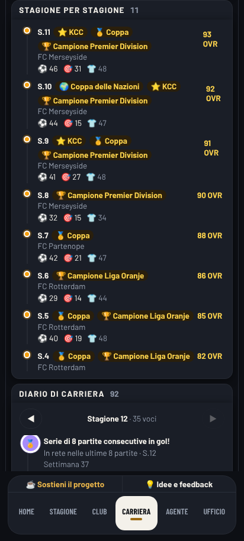
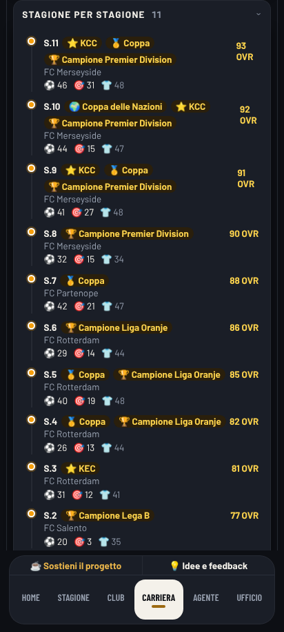
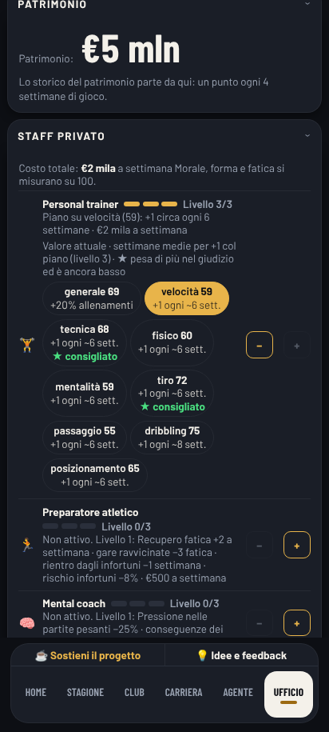
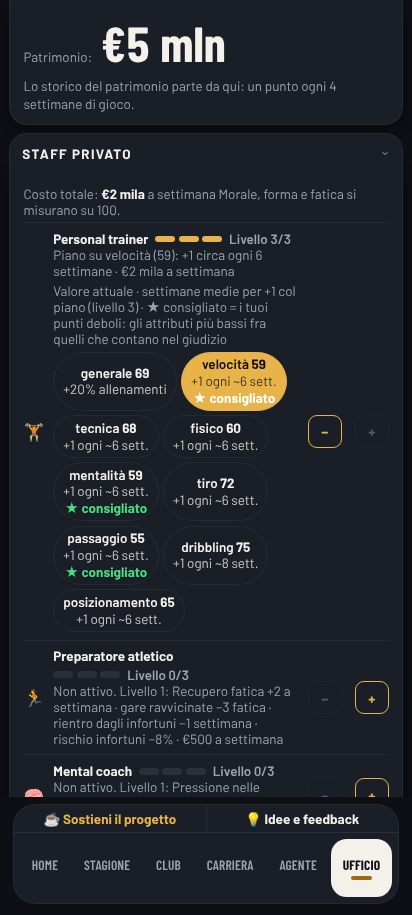

# Rapporto giro 341 — fisarmoniche del Profilo e «consigliato» del trainer (PO-618 · PO-622)

Base: `lavoro/201` punta `d681977` (7.999.206). Ramo: `sviluppo/giro341-fisarmonica-staff`. `GAME_VERSION` non toccato (rilascio
automatico acceso). Banco: sessione cloud, 4 cpu, `CPM_CHROME=/opt/pw-browsers/chromium`. Soglie: nessuna cambiata.
Rosso unico: `window.__CPM_NO_G341` = comportamento di prima su tutte e due le voci.

## 1. PO-618 — «Non riesco a richiudere questo box»

**Causa (letta nel codice e misurata).** Dal giro 235 il Profilo sta in cinque gruppi; dentro un gruppo ogni vecchia fisarmonica
diventava una **sezione fissa** (`Fisarmonica`, ramo `_gr235` in `src/11`): titolo senza tasto e senza freccia, quindi niente da
toccare per richiuderla. In più quattro sezioni avevano una lista con `maxHeight` + `overflowY:auto` (giro 7.999.54): al telefono il
dito sopra la lista scorre la lista e non la pagina. Misurato dal guardiano sul braccio rosso, carriera di prova `save-190` (11 stagioni):

| sezione | riquadro visibile / contenuto | 
|---|---|
| Stagione per stagione | 520 / 721 px |
| Diario di carriera | 440 / 2.566 px |
| Memoria della carriera | 360 / 1.361 px |
| Migliore del mese | 360 / 1.104 px |

Rotella di 300 px sopra la lista delle stagioni: la pagina si sposta di **0 px** (prima) → **300 px** (dopo).
Sezioni con testata-tasto: **0 su 22** (prima) → **22 su 22** (dopo).

**Correzione.**
- `src/11` (`Fisarmonica`, ramo dentro un gruppo): la testata è un `<button aria-expanded>` con la stessa freccia `›` della Fisarmonica
  (ruota di 90° quando è aperta), stesso tocco minimo 44 px, stesso raggio del giro 299. Si apre e chiude dalla testata. Di partenza
  è **aperta** (come prima: chi apre un gruppo vede le sezioni come le vedeva); la scelta resta per sezione in `cpm-sez341-<id>`
  (chiave nuova: le vecchie `cpm-fis-*` del periodo prima dei gruppi potevano chiudere a sorpresa sezioni che il giocatore non aveva
  mai chiuso).
- `src/18`: le quattro liste (Stagione per stagione, Diario, Memoria, Migliore del mese) non hanno più scorrimento interno
  (`_scorri341`, `src/01`): la pagina scorre tutta; per accorciare si chiude la sezione dalla testata.
- Altre fisarmoniche: le **22 sezioni** dei cinque gruppi del Profilo avevano lo stesso difetto (nessun comando per chiudere) e sono
  tutte corrette dallo stesso punto (il componente). Le fisarmoniche fuori dal Profilo avevano già la freccia. Gli altri
  `overflowY:auto` del file (finestre modali, «Club dei sogni», lista allenamenti) non stanno dentro una fisarmonica e restano fuori ambito.

| prima (rosso) | dopo |
|---|---|
|  |  |

Foto al telefono 412×915 col tocco: a destra la freccia nella testata e la lista intera (S.11 … S.2) senza barra interna.

## 2. PO-622 — «consigliato deve essere sui punti deboli!»

**Regola di prima** (giro 83, PO-288): punteggio = peso nel giudizio × (99 − valore), primi 2 sotto 85. I pesi sono quelli di
`calcOvr` (tiro 2,5 · tecnica 2 · velocità/dribbling/posizionamento 1,5 · mentalità/fisico/passaggio 1): il peso schiacciava il
valore. Coi numeri della foto PO: tiro 72 → 2,5×27 = **67,5**; tecnica 68 → 2×31 = **62**; velocità 59 → 1,5×40 = 60; passaggio 55 →
1×44 = 44. Quindi la stella andava su tiro 72 e tecnica 68, cioè su due punti di forza.

**Regola nuova** (`trainerAiuto288`, `src/08`):
1. candidate le caratteristiche che **contano nel giudizio** (peso in `calcOvr` ≥ 1) e sono sotto 85;
2. si ordinano per **valore crescente**; a pari valore prima quella che pesa di più, poi l'ordine dei pulsanti;
3. «★ consigliato» va alle **due più basse** e a chi è **a pari merito con la seconda** (tetto 3).

Esempio numerico (foto PO 202): valori 55 passaggio · 59 velocità · 59 mentalità · 60 fisico · 65 posizionamento · 68 tecnica ·
72 tiro · 75 dribbling. Le due più basse sono passaggio 55 e velocità 59; mentalità 59 è a pari merito con la seconda → stella su
**passaggio, velocità, mentalità** (le tre che il PO ha indicato); tecnica 68 e tiro 72 no.
Legenda: «★ consigliato = i tuoi punti deboli: gli attributi più bassi fra quelli che contano nel giudizio»; il suggerimento al
passaggio del mouse dice «Punto debole: è fra i tuoi attributi più bassi e conta nel giudizio».

⚠️ **Detto con onestà:** il gioco non ha pesi per ruolo. `calcOvr` è una formula sola per tutti e tutte e otto le caratteristiche
pesano (minimo 1), quindi oggi «che contano per il ruolo» vuol dire «tutte». La regola è scritta in modo che, se un giorno nascono
pesi per ruolo con peso 0 per qualche caratteristica, quella esce da sola dalle candidate. Non ho aggiunto l'etichetta «punto di
forza» sugli attributi alti: è una scelta aperta (sotto, dubbio 2).

| prima (rosso) | dopo |
|---|---|
|  |  |

## 3. Guardiano `npm run fisarmonica-341`

Telefono 412×915 col tocco, gioco vero (`?cpmtest=1`). Giudica:
- **A** ogni sezione dei gruppi del Profilo ha testata-tasto con `aria-expanded` e freccia (almeno 10 censite, se no non giudicato);
  «Stagione per stagione» si chiude dalla testata (corpo sparito, sezione da 873 a 40 px) e si riapre;
- **S** nessun riquadro dentro le sezioni con scorrimento interno, e una rotella di 300 px sopra la lista delle stagioni sposta la
  lista nella pagina di almeno 150 px;
- **C** coi valori della foto PO la stella cade esattamente sull'insieme calcolato dal guardiano con la regola scritta da capo
  (senza leggere il gioco): {passaggio, velocità, mentalità}; legenda con «punti deboli».

Esito misurato: VERDE passa A, S, C; ROSSO `__CPM_NO_G341` cade su **A, S e C** (22 sezioni senza tasto · 4 trappole · rotella 0 px ·
consigliato {tecnica, tiro}). «Non giudicato» ed errori di pagina = rosso. Foto con `CPM_FOTO=<cartella>`.
Nella MAPPA è nelle righe che esistono già per i file toccati: `src/18-|src/16-|src/10-`, `src/1[17]-`, `src/0[0-8]-`
(`npm run mappa-unica` verde).

`trainer-288` codificava la regola vecchia nel controllo C: allineato alla regola nuova (decisione PO 22/11 11:30), tetto 3 per il
pari merito. Rigiocato: verde, col suo rosso `__CPM_NO_PT288` che cade ancora su V, R, C.

## 4. Catena eseguita

`node ci-runner.mjs giro fisarmonica-341 design-system tocco-213 career-critical trainer-288` (+ le 17 sentinelle) sul build
7.999.206 + modifiche del giro: **20/20 verdi** al primo tentativo, nessun passo instabile.
Passi (durata): fisarmonica-341 (26s) · design-system (1s) · trainer-288 (12s) · mappa-unica (0s) · test:logic (3s) · save-compat (2s) · replay (83s) · migrazione-194 (28s) · tema-unico (15s) · griglia-mobile (222s) · render-3d-023 (39s) · tunnel-285 (310s) · home-298 (122s) · web-237 (65s) · tocco-213 (261s) · career-critical (369s) · battito-264 (437s) · partita-vera (747s) · gk-dive-sync (207s) · schermate-97 (138s).
Prima, fuori catena: `npm run mappa-unica` verde, `npm run trainer-288` verde (rosso che cade su V, R, C).

## 5. Dubbi per il PO

**D1 — Stato di partenza delle sezioni dentro un gruppo.**
1. *(consigliata)* Aperte di partenza, la scelta di chiudere resta per sezione: chi apre «Storia» vede tutto come prima e chiude
   ciò che non gli serve.
2. Chiuse di partenza: aprendo un gruppo si vede solo l'elenco dei titoli; più ordinato, ma un tocco in più per leggere.
3. Aperta solo la prima sezione di ogni gruppo, le altre chiuse.

**D2 — «Punto di forza» sugli attributi alti.**
1. *(consigliata)* Niente seconda etichetta per ora: la stella dice una cosa sola (dove allenarsi) e i pulsanti già mostrano il valore.
2. Aggiungere «punto di forza» (altro colore, senza stella) sulle due più alte, con una riga in legenda.
3. Mettere il «punto di forza» solo nel Profilo › Attributi, non nel pannello del trainer.

**D3 — Liste lunghe senza scorrimento interno (il Diario con 92 voci per stagione può essere lungo).**
1. *(consigliata)* Così come ora: lista intera, si accorcia chiudendo la sezione; il Diario ha già lo sfoglia per stagione.
2. Mostrare le prime N voci con un tasto «Mostra tutte» in fondo (niente scorrimento interno).
3. Rimettere lo scorrimento interno solo su PC (col mouse non intrappola), mai al telefono.
