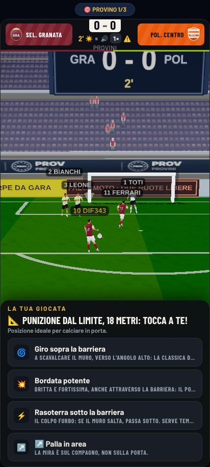
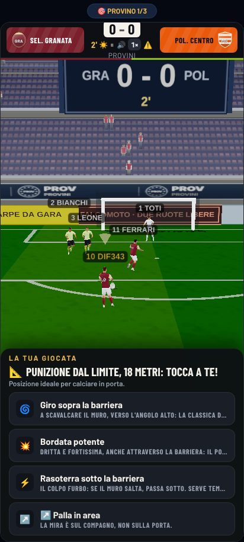

# Rapporto giro 343 — l'intervento del difensore al contatto (PO-587) · la punizione fuori area (PO-611)

Base: `lavoro/201` (fd2b933). Ramo: `sviluppo/giro343-difesa-piazzati`. GAME_VERSION non toccata.
Rosso unico per le due correzioni: `window.__CPM_NO_G343`. Guardiano: `npm run difesa-343` (verde + rosso).

## 1 · PO-587 — «il difensore scivola prima dell'effettiva giocata»

### Causa (misurata)

Su tiro, colpo di testa e cross il difensore riceve il suo gesto da due punti di `src/12`: la **reazione di reparto** (7.519: il più
vicino entro 9 u suona la scivolata o lo stacco, canale `_mateFx`) e il **muro** (giro 41: sul tiro «murato» un difensore scivola
sul punto del contatto). Tutti e due scattavano nel fotogramma in cui l'arco del pallone si **arma**. Ma il pallone non parte lì:
parte dopo il caricamento del gesto dell'eroe (`GESTURE_WIN.pre`, clip caricata del 7.999.34, contatto della clip del giro 177,
attese dei giri 53/274). Fra i due momenti il difensore era già in scivolata.

### Misura (testimone `__CPM_DIF343`, tempi di scena)

Per ogni intervento: `int` = l'intervento parte · `cont` = contatto (l'arco passa da ≤0 a >0, lo stesso fotogramma del testimone
CONT121) · `g` = il corpo GLB chiede la clip. Scarto = `int − cont`.

Scene forzate, esito fallito, **GLB acceso**, 10 scene (8-9 con un difensore entro 9 u):

| Scena | Prima (rosso) | Dopo (verde) |
|---|---|---|
| gi65 tiro murato (reparto + muro) | −0,47 s | 0,00 s |
| gi67 tiro | −0,46 s | 0,00 s |
| gi70 tiro | −0,46 s | 0,00 s |
| gi93 tiro (reparto + muro) | −0,46 s | 0,00 s |
| gi103 tiro murato (reparto + muro) | −0,46 s | 0,00 s |
| gi171 colpo di testa | −0,03 s | 0,00 s |
| gi83 cross | −0,33 s | 0,00 s |
| gi100 cross | −0,46 s | 0,00 s |
| **Interventi giudicati** | 11 | 10-12 |
| **Scarto minimo / mediano** | −0,47 / −0,46 s | 0,00 / 0,00 s |
| **Clip GLB chiesta prima del contatto** | 8 su 8 | 0 su 8-9 |

A GLB spento (censimento di tutte le 59 scene di tiro e cross del catalogo, braccio rosso): ogni scena con un difensore vicino dava
da −0,24 a −0,35 s. Il difetto era quindi di **tutte** le conclusioni con un difensore entro 9 u, non di una scena.
Sul telefono 0,46 s di scena sono quasi mezzo secondo reale: è la scivolata «prima della giocata» della nota.

### Correzione

`_dif343` (src/12, accanto a `_tiro34Arma`): la richiesta dell'intervento non si esegue più subito, entra in una coda legata alla
scena (`sr.current._pend343`) e parte nel fotogramma del contatto, subito dopo `ballArcT+=aDt`. Passano da lì la reazione di reparto e
il muro. Il muro calcola il passo della scivolata da dove l'uomo è **in quel fotogramma**, così arriva sul punto insieme al pallone
(prima partiva in anticipo con un passo calcolato sulla durata del volo).

Cosa resta com'era, per scelta:
- lo **spostamento** del difensore fra 9 e 24 u (giro 42, `_rea42`): è una corsa verso il punto, non un intervento. Che un difensore
  si muova per chiudere mentre l'eroe carica il tiro è calcio. Se il PO vede ancora «anticipo» lì, è il dubbio 1;
- la scivolata sul **dribbling** e sulla conduzione persa (5.43.5, giro 226): lì il contrasto è la giocata stessa, e il pallone già
  aspetta il difensore (0,20-0,40 s).

## 2 · PO-611 — «punizione in area!»

### Dove il punto di battuta cade in area (misurato)

L'area **disegnata** dal 3D (src/12: linea di porta 48,6, profondità 16,5, mezza larghezza 20,16 di mondo) in unità di gioco è
avanzamento ≥ 82,1 e |y−50| ≤ 29,65. Le sorgenti di una punizione, una per una:

| Sorgente | In area? | Misura |
|---|---|---|
| Schede di punizione del catalogo (7: gi13, 14, 15, 51, 78, 81, 161) | **no** | pallone a x 73-80 (linea a 82,1), tutte a movimento bloccato |
| Recite ambientali `sp` (cronaca) | **no** | il pallone della punizione è tenuto a x ≤ 70 (`clamp(_sp.x,20,70)`) |
| **Motore, fallo** (`fallo()` → `fermoSet("foul")`, src/14) | **sì** | la regola del rigore del motore è più stretta dell'area disegnata (avanzamento ≥ 84 e |y−50| ≤ 20): nella cornice fra le due il fallo era punizione. Banco 192 partite: **216 punizioni su 5.031 (4,3 %)** nell'area disegnata, fino a 15,5 u oltre la linea (falli larghi sul fondo) |
| **Scena di punizione dell'eroe** (`scenaDalMotorePiazzato` → `_p6Costruisci`, src/04) | **sì** | la scena nasce dal punto del fallo, ma la zona di partenza era quel punto ±2 in profondità e ±3 di lato, e il punto veniva **sorteggiato** lì dentro. Banco: 94 occasioni di punizione su 297 col fallo già in area; 205 su 297 con la zona di partenza che entra in area |

La foto del PO (pallone a circa 3,4 u dentro l'area, stimato dalla prospettiva delle linee) corrisponde al secondo caso: fallo a
82-84 di avanzamento, scena aperta fino a 2 u più avanti. **Non posso confermare** che la partita della foto sia nata proprio così:
non ho il salvataggio di quella partita. Ho riprodotto la stessa immagine dal banco (foto «prima» qui sotto, stesso titolo «Punizione
dal limite, 18 metri» col pallone dentro l'area).

### Quale regola ho scelto, e perché

**La punizione in area esce al limite** (resta punizione diretta, con barriera). Non rigore, non indiretta:

- **Rigore**: allargare la regola del rigore all'area disegnata aumenterebbe i rigori. Il PO ha già deciso quanti rigori vuole a
  partita (PO-190, 03/10: solo un contatto su quattro in area è rigore). L'area disegnata è circa 1,7 volte quella della regola: più
  rigori, più gol dell'eroe. È una decisione di bilanciamento, non mia: dubbio 3.
- **Indiretta in area**: il motore non la sa mostrare. Non ha il secondo tocco obbligato, né la barriera sulla linea di porta: sarebbe
  una punizione diretta chiamata con un altro nome.
- **Fuori al limite**: il motore la mostra già bene (titolo con la distanza, barriera, scelte di tiro) e la regola del rigore non si
  tocca.

### Correzione

- `fuoriArea343(avanzamento, y)` (src/14, funzione pura, nessun sorteggio): un punto nell'area avversaria esce dal lato più vicino,
  1,6 u fuori dalla linea (dal limite: avanzamento 80,5; di fianco: |y−50| 31,25). La linea è area (0,3 u di margine).
  Chiamata dentro `fermoSet` per ogni fermo «foul»: copre il fallo, il fuorigioco e il ponte del live (`chiedi.piazzato`).
  Una punizione per chi difende nella **propria** area resta dov'è (è regolare).
- `_p6Costruisci` (src/04): per la sola punizione, il punto passa da `fuoriArea343` e la zona di partenza è il punto esatto del fallo
  (il titolo dice già la distanza da lì). Il rigore e le altre scene non cambiano.

### Prima / dopo

| | Prima (rosso) | Dopo (verde) |
|---|---|---|
| Motore, 192 partite: punizioni nell'area disegnata | 216 su 5.031 | **0 su 5.072** |
| Occasioni «punizione» dell'eroe col fallo in area | 94 su 297 | **0 su 281** |
| Scena dal fallo a (83,6;46) | pallone 3,5 u **dentro** l'area | 1,6 u **fuori** |
| Scena dal fallo a (83,9;56) | 3,8 u dentro | 1,6 u fuori |
| Scena dal fallo a (82,6;50) | 2,5 u dentro | 1,6 u fuori |
| Scena dal fallo a (83;38) | 2,9 u dentro | 1,6 u fuori |
| Controllo, fallo a (79;50) | fuori (1,1 u) | fuori (3,1 u) |

Foto GLB acceso, scena costruita dal fallo a (83,6;46), aperta da partita vera:

| Prima | Dopo |
|---|---|
|  |  |

Le foto «prima/dopo» dell'intervento del difensore non ci sono: nella scena fotografata la camera del gioco al contatto non inquadra
il difensore, e una foto che non lo mostra non prova niente. Per PO-587 la prova sono i tempi del testimone.

### Effetto sul bilanciamento (misurato, 1.920 partite per braccio)

Spostare il punto di 4 punizioni su 100 cambia il seguito di quelle partite. Gol: 4.901 (dopo) contro 4.917 (prima), cioè 2,55
contro 2,56 a partita. Rigori: 570 contro 537 (0,297 contro 0,280 a partita, +6 %): la differenza è circa una deviazione standard
(±33), **non distinguibile dal rumore** con questa misura. Non posso escludere un piccolo effetto vero sui rigori: va guardato sul
banco grande se il PO lo vuole (dubbio 3).

## 3 · Guardiano `npm run difesa-343`

Tre parti, verde poi rosso, un «non giudicato» vale rosso:
- **(A)** node, banco del motore, 192 partite: verde = 0 punizioni e 0 occasioni in area; rosso = almeno 20 in area.
- **(B)** browser, GLB acceso, scena vera costruita da 4 falli nella cornice più 1 di controllo, aperta da partita vera col teatro
  acceso: verde = 0 col pallone in area, barriera di almeno 3 uomini mai sotto 6 u; rosso = almeno 3 su 4 in area.
- **(C)** browser, GLB acceso, 10 scene di tiro/testa/cross fallite: verde = scarto ≥ 0 su tutte (anche la clip GLB); rosso = almeno
  l'80 % sotto zero e mediana ≤ −0,2 s. Servono almeno 6 interventi giudicati e 4 con la clip GLB.

È nelle righe della MAPPA dei file toccati (`src/04`, `src/12-13`, `src/14`). Due invarianti nuovi in `CLAUDE.md`.

## 4 · Catena del giro

`node ci-runner.mjs giro difesa-343 squad-react gesture-window rigori-296 salti-274` sul build del commit f5c225d:
**22 su 22 verdi**, nessun passo ripetuto.

| Passo | Esito | | Passo | Esito |
|---|---|---|---|---|
| difesa-343 | ✅ 237 s | | tema-unico | ✅ 14 s |
| squad-react | ✅ 18 s | | griglia-mobile | ✅ 189 s |
| gesture-window | ✅ 37 s | | render-3d-023 | ✅ 37 s |
| rigori-296 | ✅ 999 s | | tunnel-285 | ✅ 264 s |
| salti-274 | ✅ 665 s | | home-298 | ✅ 120 s |
| mappa-unica | ✅ | | web-237 | ✅ 46 s |
| test:logic | ✅ | | career-critical | ✅ 343 s |
| save-compat | ✅ | | battito-264 | ✅ 409 s |
| replay | ✅ 50 s | | partita-vera | ✅ 629 s |
| migrazione-194 | ✅ 24 s | | gk-dive-sync | ✅ 201 s |
| design-system | ✅ | | schermate-97 | ✅ 129 s |

Fuori catena, perché toccano le stesse righe di codice:
- `esiti-241` (il muro del tiro murato): ✅ verde, e il rosso si vede;
- `reazione-252` (il difensore lontano che corre sul punto): ✅ verde, accorciamento mediano 7,3 u;
- `barriera-73` (compattezza della barriera su gi81): ❌ **rosso, ma lo è anche sulla base `lavoro/201` senza le mie modifiche**
  (base: 2 uomini in barriera larga 13,4 u; questo ramo: 2 uomini, 14,6 u; il suo braccio rosso dà numeri simili). Non è in nessuna
  catena di `ci-runner.mjs`, quindi nessuno lo eseguiva più. Non l'ho toccato: è il dubbio 2.

Non eseguiti in questo giro: il resto delle righe della MAPPA di `src/04`, `src/12-13` e `src/14` (li gira il trenino al push su
`lavoro/**`) e il gate completo `validate-situations`. La correzione del motore sposta il seguito delle partite in cui cade una
punizione nella cornice: un guardiano legato a una partita con seme fisso può cambiare numeri. `partita-vera`, `replay`,
`rigori-296` e `career-critical` qui sono verdi; gli altri li giudica il treno.

## 5 · Dubbi per il PO

**Dubbio 1 — il difensore lontano (9-24 u) parte ancora all'armo del tiro: va bene?**
1. *(consigliata)* Lasciarlo: è una corsa per chiudere, non una scivolata, e nel calcio il difensore si muove mentre l'attaccante
   carica. Si rivede solo se nel collaudo sembra ancora «anticipo».
2. Agganciare anche la corsa al contatto: più rigoroso, ma il difensore lontano arriverebbe sempre tardi e sembrerebbe fermo.
3. Farlo partire a metà del caricamento: via di mezzo, da tarare a occhio sul telefono.

**Dubbio 2 — la barriera sta fra 8 e 12 u dal pallone, non a 9,15 fissi.**
Misurato sui corpi (mediana di 6 s): 8,6 · 8,7 · 9,8 · 11,3 u nelle quattro scene, 11,2 u nel punto di controllo che non ho toccato.
È così da prima di questo giro (il punto di controllo lo mostra); il mio guardiano giudica solo che la barriera ci sia e non stia
sotto 6 u. La compattezza ha il suo guardiano, `barriera-73`, che però oggi è **rosso anche sulla base** e non sta in nessuna catena
(vedi §4).
1. *(consigliata)* Un giro dedicato: barriera a 9,15 m dal pallone sulla linea pallone-porta in tutte le scene, con la sua misura,
   che ripari anche `barriera-73` e gli dia una riga della MAPPA.
2. Lasciare com'è: la barriera c'è e non è addosso al pallone.
3. Stringere solo le scene costruite dal motore (quelle di questo giro) e non il catalogo.

**Dubbio 3 — un fallo dentro l'area disegnata ma fuori dalla regola del rigore del motore: punizione al limite o rigore?**
1. *(consigliata)* Punizione al limite, come fatto qui: i rigori a partita restano quelli decisi con PO-190.
2. Allargare la regola del rigore all'area disegnata tenendo «uno su quattro»: più coerente col disegno, ma più rigori (l'area
   disegnata è circa 1,7 volte più grande): da misurare sul banco prima di decidere.
3. Stringere il disegno dell'area sulla regola del motore: nessun effetto sul gioco, ma l'area non avrebbe più le misure vere.

**Dubbio 4 — la foto del PO non mostra la barriera.**
Nella scena riprodotta dal banco la barriera c'è (aperta da partita vera). Nel flusso vero la schiera il motore (src/14, muro di
tre a 9,15 u dal punto del fallo) nei due minuti prima della scena. Non ho riprodotto una partita vera con una punizione dell'eroe
in questo giro: **non posso confermare** che nel flusso vero la barriera ci sia sempre.
1. *(consigliata)* Una sonda su partite vere (come `sonda-rigore-139`) che cerchi una punizione dell'eroe e misuri la barriera
   all'apertura della scena.
2. Aspettare il prossimo collaudo del PO sulla 7.999.209 e guardare lì.
3. Forzare la barriera all'apertura di ogni scena di punizione, senza misura prima (sconsigliata: correzione alla cieca).
