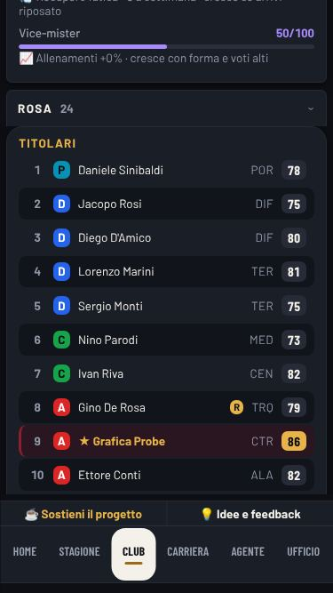
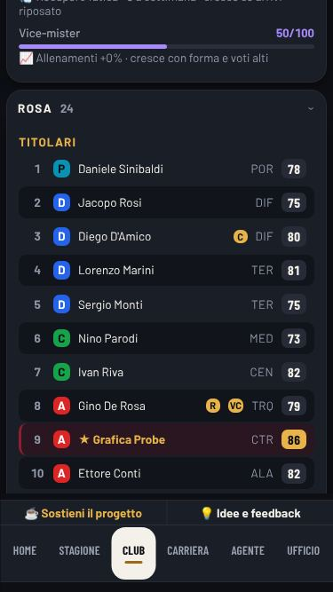
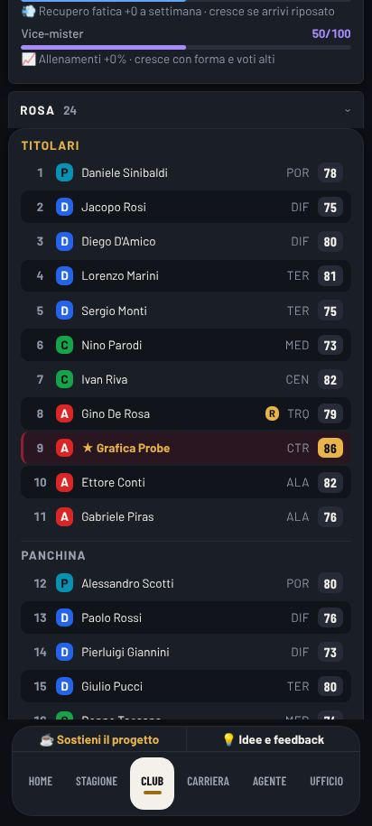
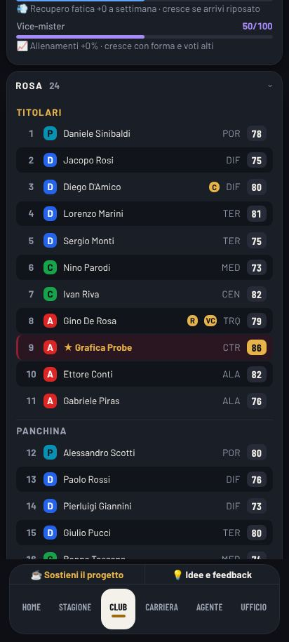
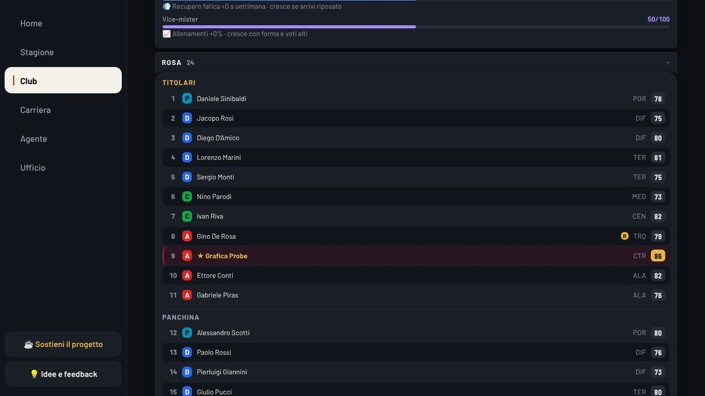
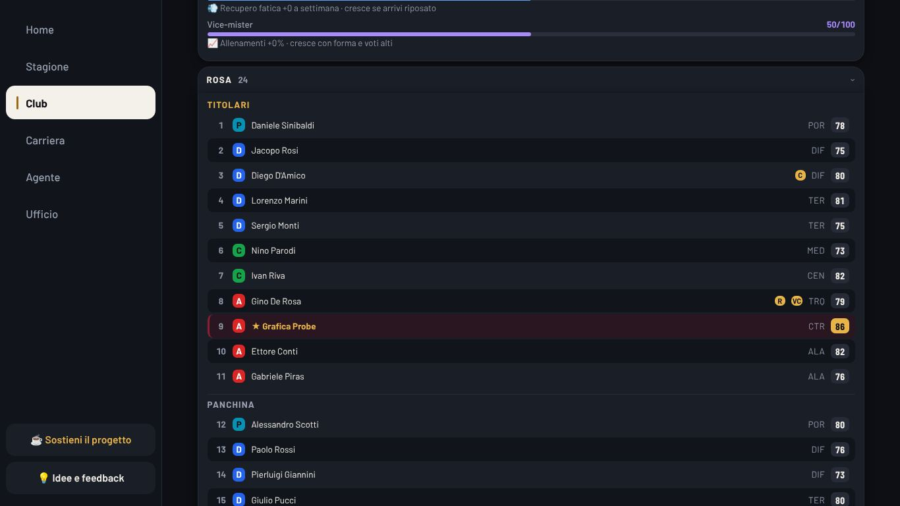

# Censimento degli angoli dei riquadri — giro 299 (PO-564)

Generato da `CPM_CENSIMENTO=1 node tests/visual/rosa-angoli-299.mjs` («dopo») e dallo stesso comando con `CPM_ROSSO=1` («prima» = braccio rosso `__CPM_NO_G299`, cioè il gioco senza le modifiche del giro). Misura: `tests/visual/lib/angoli-299.mjs`, letta dal DOM reso. Dati grezzi: `censimento-prima.json`, `censimento.json`. Tema scuro, salvataggio del banco, fisarmoniche aperte.

Taglie: telefono 375×667, telefono 412×915, PC 1366×768.

## Che cosa è un difetto

| Sigla | Difetto |
|---|---|
| T | attacco incoerente: due riquadri a filo, sul lato che si tocca uno è squadrato e l'altro tondo (la foto del PO: testata «ROSA 24» sopra il riquadro «TITOLARI») |
| D | testata e corpo attaccati bene ma con raggi esterni diversi (oltre 2 px) |
| S | figlio dipinto che esce dall'angolo tondo del padre (oltre 1 px) |
| Q | angolo squadrato senza motivo (non tocca schermo, altro riquadro, bordo del padre) |
| N | riquadro annidato più tondo del riquadro che lo contiene (oltre 1 px) |

## Totali

| Taglia | Riquadri misurati (dopo) | Difetti prima | Difetti dopo |
|---|---|---|---|
| 375 | 786 | 20 | 0 |
| 412 | 786 | 26 | 0 |
| 1366 | 781 | 26 | 0 |

Schermate misurate: 24 per taglia («prima»: 23; nel braccio rosso il tasto audio della serata non esiste, quindi «Serata · pannello audio» non c'è). Schermate saltate: prima 0, dopo 0. Errori di pagina: prima 0, dopo 0.

## Per schermata (T/D/S/Q/N, prima → dopo)

| Schermata | 375 | 412 | 1366 |
|---|---|---|---|
| Home fuori carriera | 0/0/0/0/0 → 0/0/0/0/0 | 0/0/0/0/0 → 0/0/0/0/0 | 0/0/0/0/0 → 0/0/0/0/0 |
| Opzioni | 0/0/0/0/0 → 0/0/0/0/0 | 0/0/0/0/0 → 0/0/0/0/0 | 0/0/0/0/0 → 0/0/0/0/0 |
| Creazione | 0/0/0/0/0 → 0/0/0/0/0 | 0/0/0/0/0 → 0/0/0/0/0 | 0/0/0/0/0 → 0/0/0/0/0 |
| Provini · prima del provino | 0/0/0/0/0 → 0/0/0/0/0 | 0/0/0/0/0 → 0/0/0/0/0 | 0/0/0/0/0 → 0/0/0/0/0 |
| Offerte ricevute | 0/0/0/0/0 → 0/0/0/0/0 | 0/0/0/0/0 → 0/0/0/0/0 | 0/0/0/0/0 → 0/0/0/0/0 |
| Home di carriera | 0/0/0/0/0 → 0/0/0/0/0 | 0/0/0/0/0 → 0/0/0/0/0 | 0/0/0/0/0 → 0/0/0/0/0 |
| Stagione · Classifica | 0/0/0/0/0 → 0/0/0/0/0 | 0/0/0/0/0 → 0/0/0/0/0 | 0/0/0/0/0 → 0/0/0/0/0 |
| Stagione · Calendario | 0/0/0/0/10 → 0/0/0/0/0 **(10 → 0)** | 0/0/0/0/10 → 0/0/0/0/0 **(10 → 0)** | 0/0/0/0/10 → 0/0/0/0/0 **(10 → 0)** |
| Stagione · Coppe | 0/0/0/0/0 → 0/0/0/0/0 | 0/0/0/0/0 → 0/0/0/0/0 | 0/0/0/0/0 → 0/0/0/0/0 |
| Club · rosa | 2/0/0/0/0 → 0/0/0/0/0 **(2 → 0)** | 2/0/0/0/0 → 0/0/0/0/0 **(2 → 0)** | 2/0/0/0/0 → 0/0/0/0/0 **(2 → 0)** |
| Carriera · Profilo | 0/0/0/0/2 → 0/0/0/0/0 **(2 → 0)** | 0/0/0/0/8 → 0/0/0/0/0 **(8 → 0)** | 0/0/0/0/8 → 0/0/0/0/0 **(8 → 0)** |
| Carriera · Nazionale | 0/0/0/0/0 → 0/0/0/0/0 | 0/0/0/0/0 → 0/0/0/0/0 | 0/0/0/0/0 → 0/0/0/0/0 |
| Agente | 0/0/0/0/5 → 0/0/0/0/0 **(5 → 0)** | 0/0/0/0/5 → 0/0/0/0/0 **(5 → 0)** | 0/0/0/0/5 → 0/0/0/0/0 **(5 → 0)** |
| Ufficio | 0/0/0/0/0 → 0/0/0/0/0 | 0/0/0/0/0 → 0/0/0/0/0 | 0/0/0/0/0 → 0/0/0/0/0 |
| Finestra · offerta di trasferimento | 0/0/0/0/1 → 0/0/0/0/0 **(1 → 0)** | 0/0/0/0/1 → 0/0/0/0/0 **(1 → 0)** | 0/0/0/0/1 → 0/0/0/0/0 **(1 → 0)** |
| Finestra · il mister ti cerca | 0/0/0/0/0 → 0/0/0/0/0 | 0/0/0/0/0 → 0/0/0/0/0 | 0/0/0/0/0 → 0/0/0/0/0 |
| Finestra · prima della partita | 0/0/0/0/0 → 0/0/0/0/0 | 0/0/0/0/0 → 0/0/0/0/0 | 0/0/0/0/0 → 0/0/0/0/0 |
| Finestra · settimana vissuta | 0/0/0/0/0 → 0/0/0/0/0 | 0/0/0/0/0 → 0/0/0/0/0 | 0/0/0/0/0 → 0/0/0/0/0 |
| Cerimonia 2D · festa del trofeo | 0/0/0/0/0 → 0/0/0/0/0 | 0/0/0/0/0 → 0/0/0/0/0 | 0/0/0/0/0 → 0/0/0/0/0 |
| Serata di presentazione | 0/0/0/0/0 → 0/0/0/0/0 | 0/0/0/0/0 → 0/0/0/0/0 | 0/0/0/0/0 → 0/0/0/0/0 |
| Serata · pannello audio | — → 0/0/0/0/0 | — → 0/0/0/0/0 | — → 0/0/0/0/0 |
| Fine stagione | 0/0/0/0/0 → 0/0/0/0/0 | 0/0/0/0/0 → 0/0/0/0/0 | 0/0/0/0/0 → 0/0/0/0/0 |
| Premiazioni di fine stagione | 0/0/0/0/0 → 0/0/0/0/0 | 0/0/0/0/0 → 0/0/0/0/0 | 0/0/0/0/0 → 0/0/0/0/0 |
| Fine carriera | 0/0/0/0/0 → 0/0/0/0/0 | 0/0/0/0/0 → 0/0/0/0/0 | 0/0/0/0/0 → 0/0/0/0/0 |

## I difetti «prima», uno per uno (375; alle altre taglie sono gli stessi salvo dove indicato)

### Stagione · Calendario — 10 / 10 / 10 difetti alle tre taglie

- N · div «N vs FC Lariano FUORI sett. 10 · 2» (raggio 8) dentro div «N vs FC Lariano FUORI sett. 10 · 2» (raggio 6)
- N · div «V vs FC Pisano CASA sett. 9 · 3 go» (raggio 8) dentro div «N vs FC Lariano FUORI sett. 10 · 2» (raggio 6)
- N · div «V vs FC Sicania FUORI sett. 8 2–0 » (raggio 8) dentro div «N vs FC Lariano FUORI sett. 10 · 2» (raggio 6)
- N · div «N vs FC Cremona CASA sett. 7 · 2 g» (raggio 8) dentro div «N vs FC Lariano FUORI sett. 10 · 2» (raggio 6)
- N · div «P vs FC Altoadige FUORI sett. 6 · » (raggio 8) dentro div «N vs FC Lariano FUORI sett. 10 · 2» (raggio 6)
- N · div «N vs FC Modenese CASA sett. 5 · 1 » (raggio 8) dentro div «N vs FC Lariano FUORI sett. 10 · 2» (raggio 6)
- N · div «N vs FC Empolese FUORI sett. 4 · 1» (raggio 8) dentro div «N vs FC Lariano FUORI sett. 10 · 2» (raggio 6)
- N · div «V vs FC Cesenate CASA sett. 3 · 2 » (raggio 8) dentro div «N vs FC Lariano FUORI sett. 10 · 2» (raggio 6)
- N · div «N vs FC Catanzarese FUORI sett. 2 » (raggio 8) dentro div «N vs FC Lariano FUORI sett. 10 · 2» (raggio 6)
- N · div «V vs FC Leonessa CASA sett. 1 · 1 » (raggio 8) dentro div «N vs FC Lariano FUORI sett. 10 · 2» (raggio 6)

Foto: prima [375](foto-prima/375/stagione-calendario.jpg) · [412](foto-prima/412/stagione-calendario.jpg) · [1366](foto-prima/1366/stagione-calendario.jpg) — dopo [375](foto/375/stagione-calendario.jpg) · [412](foto/412/stagione-calendario.jpg) · [1366](foto/1366/stagione-calendario.jpg)

### Club · rosa — 2 / 2 / 2 difetti alle tre taglie

- T · button «ALLENATORE ›» ↕ div «Mister Mancuso Bilanciato Equilibr» — raggi 6/6/0/0 contro 16/16/16/16
- T · button «ROSA 24 ›» ↕ div «TITOLARI 1 P Daniele Sinibaldi POR» — raggi 6/6/0/0 contro 16/16/16/16

Foto: prima [375](foto-prima/375/club.jpg) · [412](foto-prima/412/club.jpg) · [1366](foto-prima/1366/club.jpg) — dopo [375](foto/375/club.jpg) · [412](foto/412/club.jpg) · [1366](foto/1366/club.jpg)

### Carriera · Profilo — 2 / 8 / 8 difetti alle tre taglie

- N · div «TU 80 GOL CARRIERA» (raggio 8) dentro div «⚽ Bruno Salvatori FC Cremona · Leg» (raggio 6)
- N · div «BRUNO 62 GOL CARRIERA» (raggio 8) dentro div «⚽ Bruno Salvatori FC Cremona · Leg» (raggio 6)
- N (solo 412 e 1366) · div «Gol stagione 14» (raggio 12) dentro div «Gol stagione 14 Assist stagione 6 » (raggio 6)
- N (solo 412 e 1366) · div «Assist stagione 6» (raggio 12) dentro div «Gol stagione 14 Assist stagione 6 » (raggio 6)
- N (solo 412 e 1366) · div «Presenze stag. 10» (raggio 12) dentro div «Gol stagione 14 Assist stagione 6 » (raggio 6)
- N (solo 412 e 1366) · div «Gol carriera 80» (raggio 12) dentro div «Gol stagione 14 Assist stagione 6 » (raggio 6)
- N (solo 412 e 1366) · div «Assist carriera 31» (raggio 12) dentro div «Gol stagione 14 Assist stagione 6 » (raggio 6)
- N (solo 412 e 1366) · div «Valore €45 mln» (raggio 12) dentro div «Gol stagione 14 Assist stagione 6 » (raggio 6)

Foto: prima [375](foto-prima/375/carriera-profilo.jpg) · [412](foto-prima/412/carriera-profilo.jpg) · [1366](foto-prima/1366/carriera-profilo.jpg) — dopo [375](foto/375/carriera-profilo.jpg) · [412](foto/412/carriera-profilo.jpg) · [1366](foto/1366/carriera-profilo.jpg)

### Agente — 5 / 5 / 5 difetti alle tre taglie

- N · button «📣 Assegna «Costruisci immagine»» (raggio 8) dentro div «Andrea Turati Rapporto con Andrea:» (raggio 6)
- N · button «Cambia procuratore» (raggio 8) dentro div «Andrea Turati Rapporto con Andrea:» (raggio 6)
- N · div «MERCATO 🔴 Chiuso riapre alla sett» (raggio 8) dentro div «Andrea Turati Procuratore · dalla » (raggio 6)
- N · div «VALORE DI MERCATO €45 mln» (raggio 8) dentro div «Andrea Turati Procuratore · dalla » (raggio 6)
- N · button «🚪 Richiedi la cessione» (raggio 8) dentro div «Chiedi al tuo procuratore di prese» (raggio 6)

Foto: prima [375](foto-prima/375/agente.jpg) · [412](foto-prima/412/agente.jpg) · [1366](foto-prima/1366/agente.jpg) — dopo [375](foto/375/agente.jpg) · [412](foto/412/agente.jpg) · [1366](foto/1366/agente.jpg)

### Finestra · offerta di trasferimento — 1 / 1 / 1 difetti alle tre taglie

- N · button.controproposta-v2 «Fai la controproposta →» (raggio 12) dentro div «🤵 Il tuo procuratore propone una » (raggio 8)

Foto: prima [375](foto-prima/375/offerta-trasferimento.jpg) · [412](foto-prima/412/offerta-trasferimento.jpg) · [1366](foto-prima/1366/offerta-trasferimento.jpg) — dopo [375](foto/375/offerta-trasferimento.jpg) · [412](foto/412/offerta-trasferimento.jpg) · [1366](foto/1366/offerta-trasferimento.jpg)

## Il caso della foto del PO: Club › Rosa

L'intestazione «ROSA 24» (testata della fisarmonica) aveva raggi 6/6/0/0 e sotto, a filo, il riquadro «TITOLARI» aveva 16/16/16/16: angoli alti tondi sotto una testata squadrata. Stesso difetto su «ALLENATORE» › riquadro del mister. Dopo: testata 16/16/0/0, corpo 0/0/16/16, zero difetti alle tre taglie.

| Taglia | Prima | Dopo |
|---|---|---|
| 375 |  |  |
| 412 |  |  |
| 1366 |  |  |

Nelle foto «dopo» si vedono anche «C» e «VC» (PO-563) accanto alla «R».

## La regola (src/11, `RAGGI299`)

1. Un riquadro ha raggio `RAD.lg`; un riquadro dentro un altro ha raggio minore o uguale a quello del padre (`RAD.md`).
2. Testata e corpo attaccati sono un riquadro solo: testata tonda sopra e squadrata sotto, corpo squadrato sopra e tondo sotto, stesso raggio.
3. La regola 2 la applica la Fisarmonica al primo e all'ultimo figlio del corpo (`[data-corpo299]`, CSS in src/19).

## Limiti della misura

- Misura i riquadri visibili con fondo o bordo dipinti, larghi almeno 48 e alti almeno 20 px; non misura ciò che è disegnato dentro un svg o una tela 3D.
- Le schermate sono quelle elencate sopra, col salvataggio del banco: una schermata che compare solo in altri stati di carriera (per esempio infortunio, prestito, tornei delle Nazionali in corso) non è stata misurata.
- La partita (2D e 3D) non è nel censimento.
- Solo tema scuro (il tema è unico).
